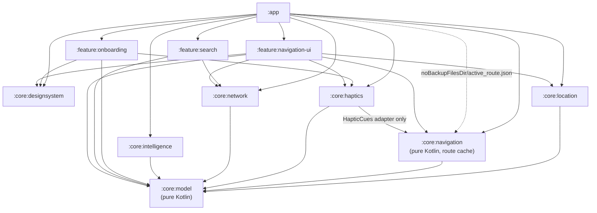
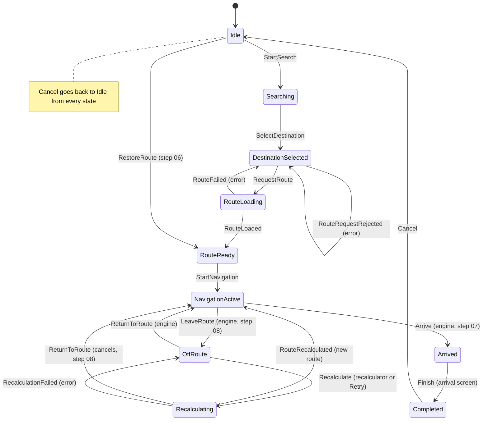
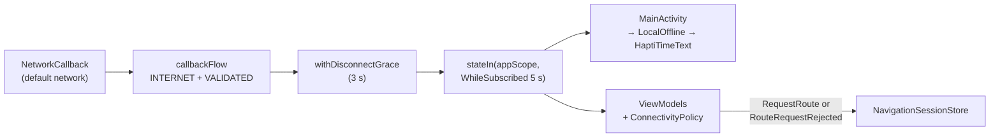
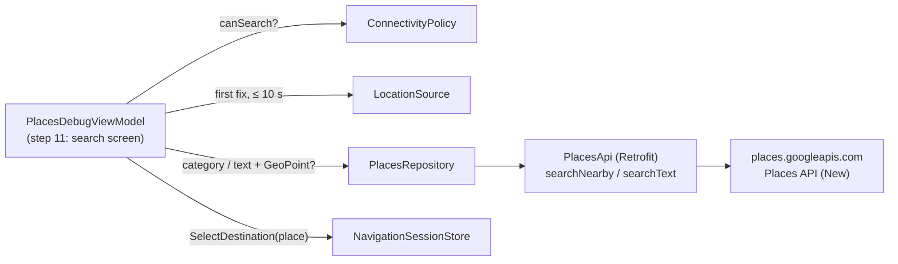
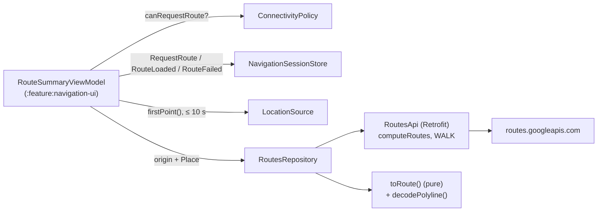
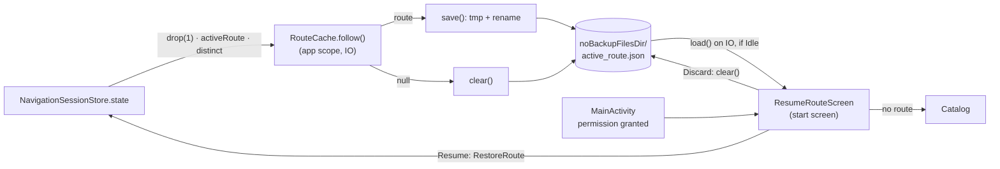
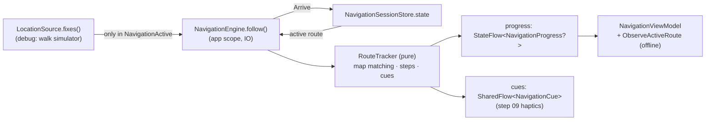
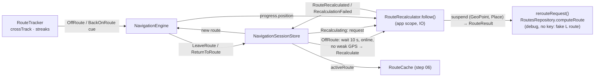
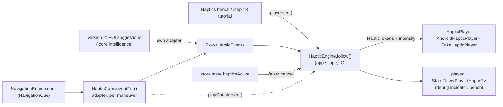

# Architecture

HaptiMap Watch is a standalone Wear OS app. The code is split into layers following section 21 of
the product document. Each layer lives in its own Gradle module, and dependencies point one way only:
`feature` → `core`, never back.

## Layers

| Layer | Module | Responsibility |
|---|---|---|
| Location Engine | `:core:location` | GPS/GNSS through Fused Location Provider; exposes `LocationSource.gpsStatus()` |
| Navigation Engine | `:core:navigation` | The navigation session state machine (step 02); the active-route cache (`RouteCache`, step 06); route tracking, maneuvers and arrival (step 07); off-route detection and recalculation (`RouteRecalculator`, step 08). Pure Kotlin |
| Intelligence Layer | `:core:intelligence` | Route evaluation and POI ranking (version 2) |
| Connectivity Layer | `:core:network` | Internet status as one app-wide `StateFlow` (`ConnectivityMonitor`, step 03); place search with Google Places (`PlacesRepository`, step 04); walking routes with Google Routes (`RoutesRepository`, step 05); `DeepSeekClient` interface + `FakeDeepSeekClient` for version 2, unused (key in `BuildConfig.DEEPSEEK_API_KEY`; must move behind a backend proxy before release, see README) |
| Haptic Engine | `:core:haptics` | Turns `HapticEvent`s into vibration patterns: priority, collapsing, gaps, playback (step 09) |
| UI | `:feature:*`, `:core:designsystem`, `:app` | Screens, design system, screen navigation and DI assembly |

Supporting module: `:core:model` (shared domain types such as `Place` and `Route`, `ConnectivityPolicy`, pure Kotlin).

## Module dependencies

`:core:designsystem` depends on no domain module: its components accept only UI values, and each
feature maps its domain to them (`DESIGN_SYSTEM.md` §1). Having no `ds --> model` edge is what lets
the build enforce it.

`:core:haptics` depends on `:core:navigation` **only** for the `HapticCues` adapter (below); `:core:navigation`
never depends on haptics.

`:core:model` and `:core:navigation` are plain Kotlin/JVM modules (`org.jetbrains.kotlin.jvm`).
They cannot import Android classes, and their tests run on the JVM without Robolectric.

## Dependency injection

Hilt with KSP. `HaptiMapApplication` is the `@HiltAndroidApp`, and `MainActivity` is an
`@AndroidEntryPoint`. Only the modules that need Hilt apply it:

| Module | What it uses |
|---|---|
| `:app` | Hilt + KSP; `di/RouteCacheModule` provides `RouteCache` on `noBackupFilesDir/active_route.json`, and `HaptiMapApplication` starts `RouteCache.follow(store.state)`, `NavigationEngine.follow(locationSource.fixes())` and `RouteRecalculator.follow(rerouteRequest(routes), connectivity.status)` on an IO scope; `di/LocationModule` is per build type: `src/release` binds `LocationSource` → `FusedLocationSource`, `src/debug` wraps it with the walk simulator (step 07); `di/ConnectivityModule` is per build type (step 08): it binds `ConnectivityMonitor` → `AndroidConnectivityMonitor` with an app-wide scope, and in `src/debug` forces `Disconnected` while the simulator's "Leave offline" mode asks for it; `rerouteRequest()` is per build type too (`src/debug`: a fake route without an API key); `di/HapticsModule` binds `HapticPlayer` → `AndroidHapticPlayer`, and `HaptiMapApplication` starts `HapticEngine.follow(engine.cues.mapNotNull(HapticCues::eventFor), store.state.map { it.hapticsActive })` (step 09); `MainActivity` draws `DebugHapticOverlay` (`src/debug`; empty in `src/release`); `di/GoogleApisModule` binds `PlacesRepository` → `GooglePlacesRepository` and `RoutesRepository` → `GoogleRoutesRepository` with the same API key, signing SHA-1 and app language |
| `:feature:onboarding` | Hilt + KSP for `PermissionViewModel` |
| `:feature:navigation-ui` | Hilt + KSP for `RouteSummaryViewModel`, `ResumeRouteViewModel`, `NavigationViewModel` |
| `:core:navigation` | Only `javax.inject` (`@Inject`, `@Singleton`); Hilt in `:app` builds the store |
| `:core:haptics` | Only `javax.inject` for `HapticEngine`; the Android player is bound in `:app` |
| `:core:location`, `:core:network` | No DI: the binding lives in `:app` |

ViewModels are `@HiltViewModel` and are obtained with `hiltViewModel()`. Each one exposes a single
`uiState: StateFlow` and takes user actions as functions. Composables only render state and
forward actions.

## Navigation session vs. screen navigation

These are two separate things:

| | Navigation session | Screen navigation |
|---|---|---|
| What | What the trip is doing | Which screen is visible |
| Where | `NavigationSession` + `reduce()` in `:core:navigation` | `HaptiMapNavHost` (`SwipeDismissableNavHost`) in `:app` |
| Owner | `NavigationSessionStore` (`@Singleton`) | The `NavController` |
| Lifetime | The process: it survives screens, ViewModels and Activity recreation, and the foreground service (step 10) reads it with the screen off | The Activity's back stack |
| Android | None | Wear Compose |

Screens observe the session (`store.state`) and send events (`store.dispatch`). The session never
knows which screens exist. The same session state can be shown by different screens (Eco, AOD,
Continuous Map), or by none at all when the service is running.

## Navigation session state machine

`reduce(state, event): NavigationSession` is a pure function. An event that does not apply to the
current state returns the same state. The store logs it as `Ignored …` (tag `HaptiSession`) and
never throws.

| State | Data |
|---|---|
| `Idle`, `Searching` | none |
| `DestinationSelected` | `destination`, `error?` (set after `RouteFailed`) |
| `RouteLoading` | `destination` |
| `RouteReady`, `NavigationActive`, `Recalculating`, `Arrived`, `Completed` | `route` |
| `OffRoute` | `route`, `error?` (set after `RecalculationFailed`) |

The destination is a `Place` and the route a `Route`, both from `:core:model` (step 05 moved
`Route` out of `:core:navigation` so that `:core:network` can build it). `RouteReady` is a loaded
route shown to the user before they start; `StartNavigation` begins navigation: the Navigation
Engine follows the route while the session is `NavigationActive` and dispatches `Arrive` (step 07). `SessionError` has `ROUTE_UNAVAILABLE` and `NO_CONNECTION`; the detailed
`RouteError` stays in the screen that requested the route.

`RouteRequestRejected` exists so that a route that must not be requested (for example while
offline) never passes through `RouteLoading`: from step 05 on, entering `RouteLoading` fires the
Routes API request.

## Connectivity

Connectivity is an **independent state**, not part of the session machine. The reducer knows
nothing about the network; whoever sends an event checks the policy first.

| Piece | Where | Responsibility |
|---|---|---|
| `ConnectivityStatus`, `Transport` | `:core:model` | `Connected(WIFI / CELLULAR / BLUETOOTH / OTHER)` or `Disconnected` |
| `ConnectivityPolicy` | `:core:model` | Section 17: `canSearch`, `canRequestRoute`, `canFetchPois` only when connected; `canContinueLoadedRoute` always |
| `ConnectivityMonitor` | `:core:network` | `status: StateFlow<ConnectivityStatus>`, one `@Singleton` for the app |
| `AndroidConnectivityMonitor` | `:core:network` | One `NetworkCallback`, registered while someone collects and released 5 s after the last one stops; a 3 s grace period before reporting `Disconnected` |
| `FakeConnectivityMonitor` | `:core:network` | `MutableStateFlow` for tests and previews |
| `LocalOffline` | `:core:designsystem` | Provided by `MainActivity`; every `HaptiTimeText` shows the offline label from it |

Losing connectivity never changes the session: an active route keeps going. Step 06 keeps this:
screens that show a route get the offline condition from `ObserveActiveRoute` (below), not from
the session.

### Adding the version 2 POI states

`PoiDetected`, `PoiSuggestion` and `Detour` will be new subtypes of the sealed `NavigationSession`
that carry the active `route` (plus the POI). They will come with new events (for example
`PoiFound`, `AcceptSuggestion`, `DismissSuggestion`, `EndDetour`). The reducer branches on the
event, and each branch only matches the states it applies to, so:

- the existing branches stay unchanged; a new event adds one branch;
- an existing event that should also work in a POI state (for example `LeaveRoute` during a
  `Detour`) only gains an extra `state is …` check in its own branch;
- `Cancel` already covers every state;
- the compiler flags every `when (session)` in the UI that needs a label for the new states.

## Place search (step 04)

| Piece | Where | Responsibility |
|---|---|---|
| `Place`, `GeoPoint.distanceTo` (haversine), `PlaceSearchResult`, `PlaceSearchError` | `:core:model` | The destination type and explicit search outcomes, pure Kotlin |
| `PlaceCategory.placeTypes` / `categoryForPlaceType` | `:core:network` (`PlaceTypes.kt`) | The only category ↔ Places type mapping |
| `PlacesApi`, `createPlacesApi` | `:core:network` | REST endpoints, the field mask, and an OkHttp interceptor that adds `X-Goog-Api-Key`, `X-Android-Package` and `X-Android-Cert` to every request |
| `GooglePlacesRepository` | `:core:network` | Checks `canSearch` (no request offline) and the location, builds the request, maps HTTP errors and computes each place's distance. Logs under the tag `HaptiPlaces` |
| `FakePlacesRepository` | `:core:network` | Fixed result, for tests and previews |
| `SearchStatus`, `PlaceCategory.label`, `Place.toRowItem()` | `:app` (`presentation/places/PlaceUi.kt`) | Domain → design-system values for the search UI (to `:feature:search` in step 11) |
| `Context.appLanguage()` | `:core:designsystem` | The app language ("en" / "es") from the Context's `Configuration`: the Places `languageCode` and `formatDistance()` both use it |

The ViewModel checks `ConnectivityPolicy.canSearch` itself before waiting for a GPS fix. Offline,
the message appears at once instead of after the fix. The repository checks again before every
request, so no caller can make a request while offline.

## Walking routes (step 05)

| Piece | Where | Responsibility |
|---|---|---|
| `Route`, `RouteStep`, `Maneuver`, `RouteResult`, `RouteError`, `decodePolyline`, `Route.firstManeuver()` | `:core:model` | The route as the Navigation and Haptic engines will read it. No Google strings: `Maneuver` is `TURN_LEFT`, `TURN_RIGHT`, `CONTINUE`, `ARRIVAL` |
| `RouteStatus`, `Route.toSummary()`, `RouteStatusMessage` | `:feature:navigation-ui` (`RouteUi.kt`) | Domain → design-system values for the route screen |
| `googleRetrofit`, `isApiKeyConfigured` | `:core:network` (`GoogleApi.kt`) | One OkHttp client and JSON config for Places and Routes; the placeholder key counts as no key |
| `RoutesApi`, `ROUTES_FIELD_MASK` | `:core:network` | `POST directions/v2:computeRoutes`; the field mask is one constant |
| `toRoute()`, `maneuverFor()`, `Place.toWaypoint()` | `:core:network` (`RouteMapper.kt`) | Pure DTO ↔ domain mapping, tested with JSON fixtures. The destination is its place ID when it has one, else its coordinates |
| `GoogleRoutesRepository` | `:core:network` | Exposes `hasApiKey`, which the ViewModel checks before waiting for GPS. No key → `MISSING_KEY`, offline → `NO_CONNECTION`, no fix → `NO_LOCATION`, all without a request. Maps HTTP errors like Places. Logs under `HaptiRoutes` |
| `LocationSource.firstPoint()` | `:core:location` | The first usable fix with the 10 s timeout, shared by Places and Routes |

## Route cache (step 06)

The active route is kept on the device so navigation continues offline and survives process
death. It is not offline navigation: search, new routes and recalculation still need the network.

| Piece | Where | Responsibility |
|---|---|---|
| `NavigationSession.activeRoute` | `:core:navigation` | The route of `RouteReady`, `NavigationActive`, `OffRoute`, `Recalculating`; null otherwise. One definition for the cache and the UI |
| `RouteCache(file, maxAge = 6 h, nowMillis)` | `:core:navigation` | `save` / `load` / `clear` / `follow`. JSON through private DTOs (`CachedRouteFile` with `version` and `savedAtMillis`); polylines stored encoded (`encodePolyline`, `:core:model`). `load()` returns null without throwing for a missing, corrupted, other-version, expired or step-less entry, and deletes the invalid file. Logs under `HaptiRouteCache` |
| `NavigationEvent.RestoreRoute(route)` | `:core:navigation` | `Idle` → `RouteReady` only |
| `ObserveActiveRoute` | `:feature:navigation-ui` | `combine(store.state, connectivity.status)` → `ActiveRoute(route, offline)?`. Used by `RouteSummaryViewModel`, `NavigationViewModel` and `SessionDebugViewModel` |
| `ResumeRouteViewModel` / `ResumeRouteScreen` | `:feature:navigation-ui` | The start screen once location is granted. Reads the cache on the injected `CoroutineDispatcher` (`Dispatchers.IO`, from `RouteCacheModule`) showing only the background, and "Loading…" only if the read takes longer than `SLOW_LOAD_THRESHOLD` (300 ms, `withSlowNotice()` in `:core:model`, reusable by any load); no route or session not `Idle` → catalog; Resume → `RestoreRoute` → route summary; Discard → `clear()` → catalog |

**Lifecycle.** Saved on every new active route (`RouteReady`, and `RouteRecalculated` replaces it);
kept through `NavigationActive` / `OffRoute` / `Recalculating`; cleared when the session leaves them
(`Arrived`, `Completed`, `Cancel`, a new search). The first value (`Idle` at process start) is
skipped, so the saved route survives until the user answers the resume prompt. Writes are atomic
(temp file + rename): a process killed mid-write leaves the previous file whole.

**Offline.** Network actions already fail fast through `ConnectivityPolicy` before any request:
route request and retry (`RouteSummaryViewModel.loadRoute`), search (`PlacesDebugViewModel`).

## Navigation Engine (step 07)

| Piece | Where | Responsibility |
|---|---|---|
| `bearingTo`, `offset`, `interpolate`, `projectOnto`, `MeasuredPath` | `:core:model` (`GeoMath.kt`) | Pure walking-scale geometry; `MeasuredPath` is a polyline with cumulative meters, `pointAt(m)` and per-segment projection |
| `NavigationThresholds` | `:core:navigation` | Every engine threshold in one data class (defaults below), plus the progress filter gains; step 14 tunes them |
| `RouteTracker(route, thresholds)` | `:core:navigation` | Pure and stateful, no clock: `update(fix) → TrackingUpdate(progress, cues)`, `signalLost()`. Replay-tested |
| `NavigationProgress` | `:core:navigation` | `stepIndex`, `nextManeuver`, `distanceToManeuverMeters`, `remainingMeters`, `remainingTime`, `crossTrackMeters?`, `fixAccuracyMeters?`, `weakSignal`; step 08: `offRoute`, `position?` (the last good fix) |
| `NavigationCue` | `:core:navigation` | `ManeuverApproaching`, `ManeuverImminent`, `ManeuverPassed` (each with `stepIndex`, `maneuver`), `Arrived`; step 08: `OffRoute`, `BackOnRoute`, `Rerouted`. Not `NavigationEvent`: cues don't move the session |
| `NavigationEngine` | `:core:navigation` (`@Singleton`) | `follow(fixes)`: a new tracker per navigated route (`NavigationSession.navigatingRoute`: `NavigationActive`, `OffRoute`, `Recalculating` keep the same one; `RouteRecalculated` starts a new one and emits `Rerouted`), collects the cold `fixes` only while navigating, times silence for the weak signal, emits cues with `tryEmit` (buffer 16), dispatches `Arrive`, `LeaveRoute`, `ReturnToRoute` |
| `simulatedWalk`, `simulatedGpsStatus`, `WalkSimulation` | `:core:location` | A walk along a polyline at a speed, with seeded noise and poor-accuracy spikes; only bound in debug builds |
| `LocationSource.fixes()` | `:core:location` | The fixes of `gpsStatus()`, low accuracy included: the engine decides |
| `sampleRoute(language)` | `:app` `src/debug` (`null` stub in `src/release`) | A fixture route for demos without an API key, loaded from the catalog with `Cancel` + `RestoreRoute` |

**Map matching.** Maneuver positions are each `step.start` projected onto the route polyline, in
order. Each good fix is projected only onto the segments in a window around the current progress
(15 m behind, 30 m + 3 m/s × elapsed ahead, at most 100 m). The best candidate goes through an
alpha-beta filter (position and speed along the route, `filterAlpha` 0.3, `filterBeta` 0.05), and
progress takes the larger of the old value and the filtered position: it never goes back, a route
passing near itself can't snap to the other leg, and noise doesn't push it ahead (the maximum of raw
fixes did, by up to 10 m with 4 m of noise; see step 07). Overshooting the end uses the raw fix. The first fix searches the whole route, so a route resumed after process death picks up
mid-way without announcing the maneuvers already passed. Fixes worse than 20 m
(`LOW_ACCURACY_THRESHOLD_METERS`) don't move progress or fire cues.

**Cues and thresholds** (`NavigationThresholds` defaults; product document §13):

| Cue / flag | When | Default |
|---|---|---|
| `ManeuverApproaching` | along-route distance to the maneuver ≤ `approachMeters` | 18 m |
| `ManeuverImminent` | ≤ `imminentMeters` (the value most likely to need tuning, see step 07) | 6 m |
| `ManeuverPassed` | progress ≥ maneuver + `passedMeters`; the step and next maneuver advance here | 5 m |
| `Arrived` | remaining ≤ `arrivalRadiusMeters` + min(accuracy, `arrivalAccuracyAllowanceMeters`); overshooting leaves remaining at 0 | 10 m + ≤ 10 m |
| `weakSignal` | no fix within `maxAccuracyMeters` for `weakSignalAfter` (bad fixes or silence) | 20 m, 10 s |

Each cue fires exactly once per maneuver. A fix that skips thresholds emits the missed ones in order
in the same update, ordered by maneuver. The departure (step 0) has no cues; the arrival step has
`Approaching`, then `Arrived`. Off-route fixes don't move progress or fire maneuver cues (step 08, below).

**Screens.** Start on the route summary replaces it with `NavigationScreen`; the session drives what
it shows (`NavigationActive` → guidance, `Arrived` / `Completed` → arrival). Stop asks with
`ConfirmDialog` and dispatches `Cancel` (cache cleared, no resume); "New search" on the arrival
dispatches `Finish` and opens search. Leaving the screen doesn't stop navigation.

## Off route and recalculation (step 08)

**Detection** (`RouteTracker`, pure, timed by the fixes; defaults in `NavigationThresholds`, all step 14 candidates):

| Rule | Default |
|---|---|
| A good fix (≤ 20 m accuracy) is *off* when `crossTrack > offRouteMeters + min(accuracy, offRouteAccuracyAllowanceMeters)` | 20 m + ≤ 10 m |
| **OffRoute** is declared when off fixes are consecutive for `offRouteAfter` **and** number at least `offRouteMinFixes` | 5 s, 3 fixes |
| **BackOnRoute** (hysteresis): `crossTrack ≤ backOnRouteMeters + min(accuracy, allowance)` for `backOnRouteFixes` consecutive fixes | 12 m + ≤ 10 m, 2 fixes |

- Poor-accuracy fixes neither count nor break a streak; when the weak-signal flag turns on (10 s without a good fix, or silence) the streaks reset, so nothing is declared from fixes before a gap.
- An off fix, or any fix while off route, doesn't move progress or fire maneuver cues, and the filter restarts from the next on-route fix (the speed from before the detour no longer predicts anything). Arrival is still checked on an undeclared off fix (overshooting the end), not while off route.
- `crossTrack` is measured inside the matching window, so a route passing near itself never counts as "on route" for the other leg; cutting across to it is off route. While off route the window keeps growing ahead (up to 100 m), so rejoining a little further on is found.
- Walking the wrong way has no rule of its own (deferred to step 14): the window looks only 15 m behind, so walking back along the route becomes off route after about 40–55 m.

**Recalculation policy** (`RouteRecalculator`, timed with a `TimeSource` and `delay`, so tests run in virtual time):

| When | What |
|---|---|
| OffRoute declared | Wait `recalculationDelay` (10 s): a user who turns back at the alert rejoins without a request. Then wait until online and until GPS isn't weak, then `Recalculate` |
| Entering `Recalculating` (automatic or the screen's Retry) | Keep at least `recalculationMinInterval` (15 s) since the previous request; request from `progress.position` to `route.destination` (`Place.toWaypoint()`: place ID, else coordinates). Offline or no position: `RecalculationFailed` without a request |
| Success | `RouteRecalculated` → `NavigationActive(newRoute)`: the cache saves it, the engine starts a new tracker and emits `Rerouted` |
| Failure | `RecalculationFailed` → `OffRoute(route, error)` (old route and destination kept). Automatic retries back off 15 → 30 → 60 s (`recalculationMaxBackoff`), at most `maxAutoRecalculations` (4) per episode; `MISSING_KEY`, `API_INVALID_KEY`, `API_QUOTA` stop them at once. Retry always works (and respects the 15 s gap) |
| Rejoin while `Recalculating` | `ReturnToRoute` leaves the state; `collectLatest` cancels the request. A response that couldn't be cancelled is dispatched and ignored by the reducer (`Ignored RouteRecalculated … in NavigationActive`) |

Offline time doesn't count toward the 4 attempts. Every request is logged under `HaptiReroute` with
its number, episode and attempt (`Request #3 (episode 2, auto 1/4) from … to …`), plus its outcome or
cancellation, so API usage can be counted from logcat.

**Cues** (`NavigationCue`, for step 09), each once per episode, in order: `OffRoute` when declared;
then either `BackOnRoute` (rejoined, no new route) or `Rerouted` (following a recalculated route).

## Haptic Engine (step 09)

**The engine accepts only `HapticEvent`.** `HapticEngine.follow(events: Flow<HapticEvent>, active: Flow<Boolean>)`
and `play(event)` are its whole input; it doesn't know about routes, maneuvers or sessions. Each source
of events brings its own adapter: `HapticCues` (in `:core:haptics`, the only file that imports
`:core:navigation`) for route cues, and in version 2 the POI suggestions from the intelligence layer get
theirs, feeding the same `Flow<HapticEvent>`, without the engine depending on `:core:intelligence`.
No other module touches the `Vibrator`.

| Piece | Where | Responsibility |
|---|---|---|
| `HapticEvent`, `HapticPattern`, `HapticTokens` | `:core:model` | The vocabulary and the patterns as data, `scaled(intensity)`, `onOffTimings()` (DESIGN_SYSTEM.md §2) |
| `HapticCues` | `:core:haptics` | `NavigationCue` → `HapticEvent?`, stateful per maneuver (`stepIndex`); `NavigationSession.hapticsActive` |
| `HapticEngine` | `:core:haptics` (`@Singleton`, pure) | Scheduling (below), `intensity`, `playCount(event)`, `played`, log |
| `HapticPlayer` | `:core:haptics` | `play(event, pattern)`, `cancel()`. No scheduling |
| `AndroidHapticPlayer` | `:core:haptics` | `VibratorManager` (API 31+) or `Vibrator`; waveform with amplitudes, or on/off timings without amplitude control; capabilities detected once and logged |
| `FakeHapticPlayer` | `:core:haptics` tests | Records event, virtual time and pattern |

**Cue → event** (`HapticCues`):

| Cue | Event |
|---|---|
| `ManeuverApproaching` (left / right) | `TURN_LEFT` / `TURN_RIGHT` (the direction, at 18 m) |
| `ManeuverApproaching` (continue) | `CONTINUE` |
| `ManeuverApproaching` (arrival) | — (`Arrived` says it) |
| `ManeuverImminent` (left / right) | `TURN_IMMINENT`, **or the direction if it hasn't played yet for that maneuver** |
| `ManeuverImminent` (continue) | — |
| `ManeuverPassed` | — (silence confirms) |
| `Arrived` / `OffRoute` | `ARRIVAL` / `OFF_ROUTE` |
| `BackOnRoute`, `Rerouted` | `BACK_ON_ROUTE` (`Rerouted` also forgets the old route's maneuvers) |

*Direction is never lost.* The adapter remembers, per `stepIndex`, the direction it asked for and the
engine's `playCount` of that event at that moment. On `ManeuverImminent`, if the count hasn't grown the
direction never played (both thresholds in one fix, or `Approaching` lost to collapsing or the pending
slot), so it asks for the direction again instead of `TURN_IMMINENT`. If it is still waiting, the two
requests collapse into one.

**Scheduling** (`HapticEngine`, coroutines, tested in virtual time):

| Rule | Value |
|---|---|
| Priority | `OFF_ROUTE` = `ARRIVAL` (4) > `BACK_ON_ROUTE` (3) > `TURN_IMMINENT` (2) > `TURN_LEFT` / `TURN_RIGHT` / `CONTINUE` (1) > `POI_SUGGESTION` (0) |
| Collapsing | After the first event, wait `COLLAPSE_WINDOW` (100 ms) and drain the queue: the highest priority plays, the newest on a tie; the rest are dropped and logged. The cues of one fix arrive within microseconds |
| No overlap, no cutting | A pattern always plays to the end, then `MIN_GAP` (600 ms) of silence. What arrives meanwhile waits in the queue and is collapsed the same way when the engine is free (one effective pending slot) |
| Stop | `active` going false (`hapticsActive`: not navigating and not `Arrived`, i.e. `Cancel` or `Finish`) cancels the vibrator and drops the queue. `Arrived` keeps it, so the arrival pattern isn't cut |
| Weak GPS | Nothing extra: the tracker already ignores poor fixes and emits no cue while the signal is weak |

**Playback.** Usage **`ALARM`** (`VibrationAttributes` on API 33+, `AudioAttributes` below): navigation
the user started keeps vibrating in the default Do Not Disturb and in the background (step 10). If the user
turns alarm vibration off, the system silences it and the app doesn't fight that. Step 25 may add a
setting to respect DND instead. Every play is logged under one tag, `HaptiHaptics`:
`play event=TURN_LEFT pattern=200/250/200ms amp=160/0/160 at=… [dropped=[…]]`, plus `cancel` and the
capabilities line `vibrator=… amplitudeControl=… sdk=…`.

**Screen off (step 10).** The haptic `follow` is launched next to `NavigationEngine.follow` in
`HaptiMapApplication`; step 10's location foreground service moves both together, unchanged. The
vibrator works with the screen off; the service keeps the process and the fixes alive.

