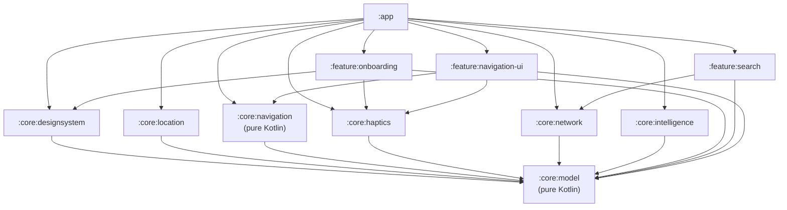
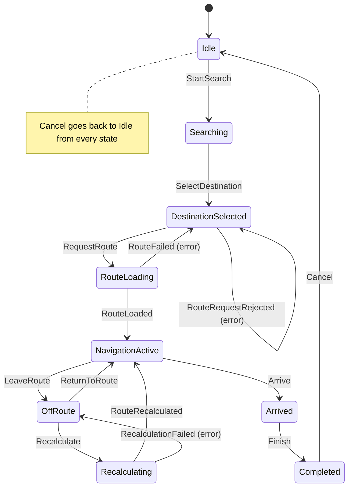
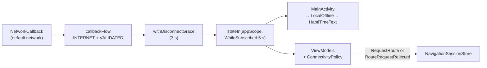
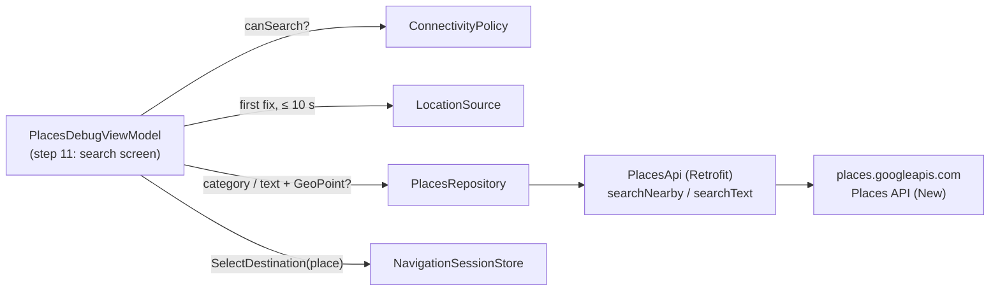

# Architecture

HaptiMap Watch is a standalone Wear OS app. The code is split into layers following section 21 of
the product document. Each layer lives in its own Gradle module, and dependencies point one way only:
`feature` → `core`, never back.

## Layers

| Layer | Module | Responsibility |
|---|---|---|
| Location Engine | `:core:location` | GPS/GNSS through Fused Location Provider; exposes `LocationSource.gpsStatus()` |
| Navigation Engine | `:core:navigation` | The navigation session state machine (step 02); route tracking, maneuvers and arrival (steps 07–08). Pure Kotlin |
| Intelligence Layer | `:core:intelligence` | Route evaluation and POI ranking (version 2) |
| Connectivity Layer | `:core:network` | Internet status as one app-wide `StateFlow` (`ConnectivityMonitor`, step 03); place search with Google Places (`PlacesRepository`, step 04); Google Routes (step 05) |
| Haptic Engine | `:core:haptics` | Turns `HapticEvent`s into vibration patterns (step 09) |
| UI | `:feature:*`, `:core:designsystem`, `:app` | Screens, design system, screen navigation and DI assembly |

Supporting module: `:core:model` (shared domain types and `ConnectivityPolicy`, pure Kotlin).

## Module dependencies

`:core:model` and `:core:navigation` are plain Kotlin/JVM modules (`org.jetbrains.kotlin.jvm`).
They cannot import Android classes, and their tests run on the JVM without Robolectric.

## Dependency injection

Hilt with KSP. `HaptiMapApplication` is the `@HiltAndroidApp`, and `MainActivity` is an
`@AndroidEntryPoint`. Only the modules that need Hilt apply it:

| Module | What it uses |
|---|---|
| `:app` | Hilt + KSP; `di/LocationModule` binds `LocationSource` → `FusedLocationSource`; `di/ConnectivityModule` binds `ConnectivityMonitor` → `AndroidConnectivityMonitor` with an app-wide scope; `di/PlacesModule` binds `PlacesRepository` → `GooglePlacesRepository` with the API key, the signing SHA-1 and the app language |
| `:feature:onboarding` | Hilt + KSP for `PermissionViewModel` |
| `:core:navigation` | Only `javax.inject` (`@Inject`, `@Singleton`); Hilt in `:app` builds the store |
| `:core:location`, `:core:network` | No DI: the binding lives in `:app` |

ViewModels are `@HiltViewModel` and are obtained with `hiltViewModel()`. Each one exposes a single
`uiState: StateFlow` and takes user actions as functions. Composables only render state and
forward actions.

## Navigation session vs. screen navigation

These are two separate things:

| | Navigation session | Screen navigation |
|---|---|---|
| What | What the trip is doing | Which screen is visible |
| Where | `NavigationSession` + `reduce()` in `:core:navigation` | `HaptiMapNavHost` (`SwipeDismissableNavHost`) in `:app` |
| Owner | `NavigationSessionStore` (`@Singleton`) | The `NavController` |
| Lifetime | The process: it survives screens, ViewModels and Activity recreation, and the foreground service (step 10) reads it with the screen off | The Activity's back stack |
| Android | None | Wear Compose |

Screens observe the session (`store.state`) and send events (`store.dispatch`). The session never
knows which screens exist. The same session state can be shown by different screens (Eco, AOD,
Continuous Map), or by none at all when the service is running.

## Navigation session state machine

`reduce(state, event): NavigationSession` is a pure function. An event that does not apply to the
current state returns the same state. The store logs it as `Ignored …` (tag `HaptiSession`) and
never throws.

| State | Data |
|---|---|
| `Idle`, `Searching` | none |
| `DestinationSelected` | `destination`, `error?` (set after `RouteFailed`) |
| `RouteLoading` | `destination` |
| `NavigationActive`, `Recalculating`, `Arrived`, `Completed` | `route` |
| `OffRoute` | `route`, `error?` (set after `RecalculationFailed`) |

The destination is a `Place` from `:core:model` (step 04 replaced the `Destination` placeholder).
`Route` is still a **placeholder**: step 05 (Routes) adds geometry and maneuvers to it. `SessionError` has
`ROUTE_UNAVAILABLE` and `NO_CONNECTION`.

`RouteRequestRejected` exists so that a route that must not be requested (for example while
offline) never passes through `RouteLoading`: from step 05 on, entering `RouteLoading` fires the
Routes API request.

## Connectivity

Connectivity is an **independent state**, not part of the session machine. The reducer knows
nothing about the network; whoever sends an event checks the policy first.

| Piece | Where | Responsibility |
|---|---|---|
| `ConnectivityStatus`, `Transport` | `:core:model` | `Connected(WIFI / CELLULAR / BLUETOOTH / OTHER)` or `Disconnected` |
| `ConnectivityPolicy` | `:core:model` | Section 17: `canSearch`, `canRequestRoute`, `canFetchPois` only when connected; `canContinueLoadedRoute` always |
| `ConnectivityMonitor` | `:core:network` | `status: StateFlow<ConnectivityStatus>`, one `@Singleton` for the app |
| `AndroidConnectivityMonitor` | `:core:network` | One `NetworkCallback`, registered while someone collects and released 5 s after the last one stops; a 3 s grace period before reporting `Disconnected` |
| `FakeConnectivityMonitor` | `:core:network` | `MutableStateFlow` for tests and previews |
| `LocalOffline` | `:core:designsystem` | Provided by `MainActivity`; every `HaptiTimeText` shows the offline label from it |

Losing connectivity never changes the session: an active route keeps going.

### Adding the version 2 POI states

`PoiDetected`, `PoiSuggestion` and `Detour` will be new subtypes of the sealed `NavigationSession`
that carry the active `route` (plus the POI). They will come with new events (for example
`PoiFound`, `AcceptSuggestion`, `DismissSuggestion`, `EndDetour`). The reducer branches on the
event, and each branch only matches the states it applies to, so:

- the existing branches stay unchanged; a new event adds one branch;
- an existing event that should also work in a POI state (for example `LeaveRoute` during a
  `Detour`) only gains an extra `state is …` check in its own branch;
- `Cancel` already covers every state;
- the compiler flags every `when (session)` in the UI that needs a label for the new states.

## Place search (step 04)

| Piece | Where | Responsibility |
|---|---|---|
| `Place`, `GeoPoint.distanceTo` (haversine), `PlaceSearchResult`, `PlaceSearchError` | `:core:model` | The destination type and explicit search outcomes, pure Kotlin |
| `PlaceCategory.placeTypes` / `categoryForPlaceType` | `:core:network` (`PlaceTypes.kt`) | The only category ↔ Places type mapping |
| `PlacesApi`, `createPlacesApi` | `:core:network` | REST endpoints, the field mask, and an OkHttp interceptor that adds `X-Goog-Api-Key`, `X-Android-Package` and `X-Android-Cert` to every request |
| `GooglePlacesRepository` | `:core:network` | Checks `canSearch` (no request offline) and the location, builds the request, maps HTTP errors and computes each place's distance. Logs under the tag `HaptiPlaces` |
| `FakePlacesRepository` | `:core:network` | Fixed result, for tests and previews |
| `Context.appLanguage()` | `:core:designsystem` | The app language ("en" / "es") from the Context's `Configuration`: the Places `languageCode` and `formatDistance()` both use it |

The ViewModel checks `ConnectivityPolicy.canSearch` itself before waiting for a GPS fix. Offline,
the message appears at once instead of after the fix. The repository checks again before every
request, so no caller can make a request while offline.
