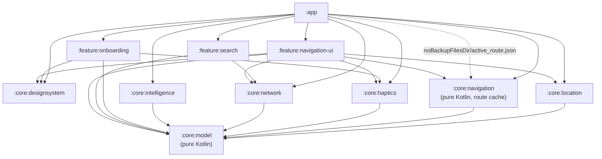
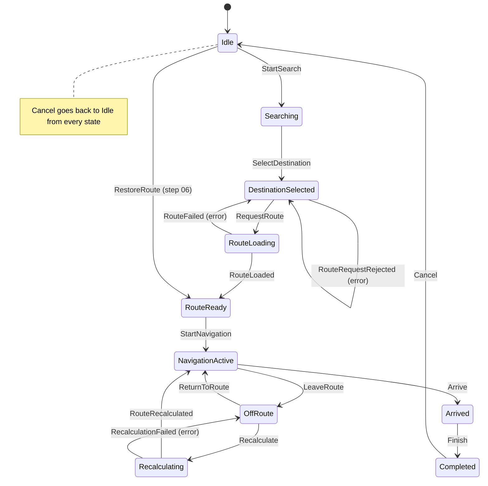
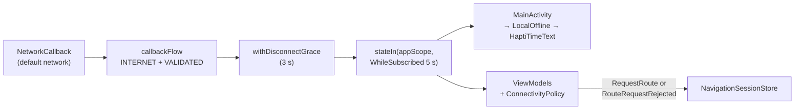
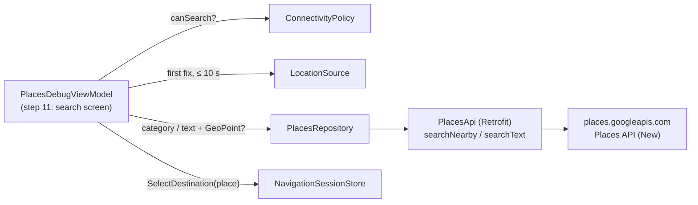
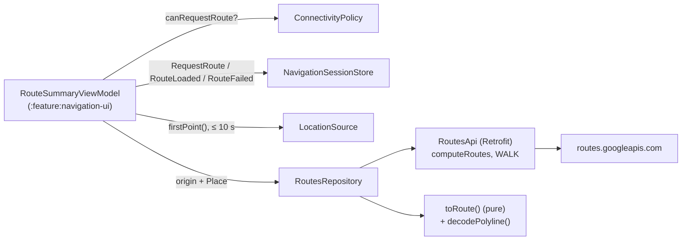
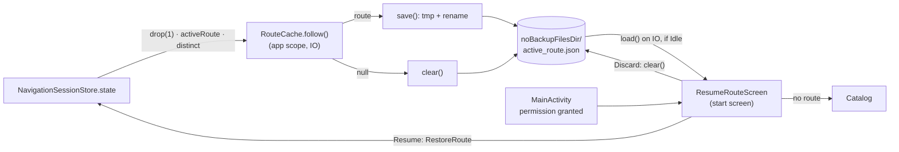

# Architecture

HaptiMap Watch is a standalone Wear OS app. The code is split into layers following section 21 of
the product document. Each layer lives in its own Gradle module, and dependencies point one way only:
`feature` → `core`, never back.

## Layers

| Layer | Module | Responsibility |
|---|---|---|
| Location Engine | `:core:location` | GPS/GNSS through Fused Location Provider; exposes `LocationSource.gpsStatus()` |
| Navigation Engine | `:core:navigation` | The navigation session state machine (step 02); the active-route cache (`RouteCache`, step 06); route tracking, maneuvers and arrival (steps 07–08). Pure Kotlin |
| Intelligence Layer | `:core:intelligence` | Route evaluation and POI ranking (version 2) |
| Connectivity Layer | `:core:network` | Internet status as one app-wide `StateFlow` (`ConnectivityMonitor`, step 03); place search with Google Places (`PlacesRepository`, step 04); walking routes with Google Routes (`RoutesRepository`, step 05) |
| Haptic Engine | `:core:haptics` | Turns `HapticEvent`s into vibration patterns (step 09) |
| UI | `:feature:*`, `:core:designsystem`, `:app` | Screens, design system, screen navigation and DI assembly |

Supporting module: `:core:model` (shared domain types such as `Place` and `Route`, `ConnectivityPolicy`, pure Kotlin).

## Module dependencies

`:core:designsystem` depends on no domain module: its components accept only UI values, and each
feature maps its domain to them (`DESIGN_SYSTEM.md` §1). Having no `ds --> model` edge is what lets
the build enforce it.

`:core:model` and `:core:navigation` are plain Kotlin/JVM modules (`org.jetbrains.kotlin.jvm`).
They cannot import Android classes, and their tests run on the JVM without Robolectric.

## Dependency injection

Hilt with KSP. `HaptiMapApplication` is the `@HiltAndroidApp`, and `MainActivity` is an
`@AndroidEntryPoint`. Only the modules that need Hilt apply it:

| Module | What it uses |
|---|---|
| `:app` | Hilt + KSP; `di/RouteCacheModule` provides `RouteCache` on `noBackupFilesDir/active_route.json`, and `HaptiMapApplication` starts `RouteCache.follow(store.state)` on an IO scope; `di/LocationModule` binds `LocationSource` → `FusedLocationSource`; `di/ConnectivityModule` binds `ConnectivityMonitor` → `AndroidConnectivityMonitor` with an app-wide scope; `di/GoogleApisModule` binds `PlacesRepository` → `GooglePlacesRepository` and `RoutesRepository` → `GoogleRoutesRepository` with the same API key, signing SHA-1 and app language |
| `:feature:onboarding` | Hilt + KSP for `PermissionViewModel` |
| `:feature:navigation-ui` | Hilt + KSP for `RouteSummaryViewModel` |
| `:core:navigation` | Only `javax.inject` (`@Inject`, `@Singleton`); Hilt in `:app` builds the store |
| `:core:location`, `:core:network` | No DI: the binding lives in `:app` |

ViewModels are `@HiltViewModel` and are obtained with `hiltViewModel()`. Each one exposes a single
`uiState: StateFlow` and takes user actions as functions. Composables only render state and
forward actions.

## Navigation session vs. screen navigation

These are two separate things:

| | Navigation session | Screen navigation |
|---|---|---|
| What | What the trip is doing | Which screen is visible |
| Where | `NavigationSession` + `reduce()` in `:core:navigation` | `HaptiMapNavHost` (`SwipeDismissableNavHost`) in `:app` |
| Owner | `NavigationSessionStore` (`@Singleton`) | The `NavController` |
| Lifetime | The process: it survives screens, ViewModels and Activity recreation, and the foreground service (step 10) reads it with the screen off | The Activity's back stack |
| Android | None | Wear Compose |

Screens observe the session (`store.state`) and send events (`store.dispatch`). The session never
knows which screens exist. The same session state can be shown by different screens (Eco, AOD,
Continuous Map), or by none at all when the service is running.

## Navigation session state machine

`reduce(state, event): NavigationSession` is a pure function. An event that does not apply to the
current state returns the same state. The store logs it as `Ignored …` (tag `HaptiSession`) and
never throws.

| State | Data |
|---|---|
| `Idle`, `Searching` | none |
| `DestinationSelected` | `destination`, `error?` (set after `RouteFailed`) |
| `RouteLoading` | `destination` |
| `RouteReady`, `NavigationActive`, `Recalculating`, `Arrived`, `Completed` | `route` |
| `OffRoute` | `route`, `error?` (set after `RecalculationFailed`) |

The destination is a `Place` and the route a `Route`, both from `:core:model` (step 05 moved
`Route` out of `:core:navigation` so that `:core:network` can build it). `RouteReady` is a loaded
route shown to the user before they start; `StartNavigation` begins navigation (step 07 hooks the
Navigation Engine there). `SessionError` has `ROUTE_UNAVAILABLE` and `NO_CONNECTION`; the detailed
`RouteError` stays in the screen that requested the route.

`RouteRequestRejected` exists so that a route that must not be requested (for example while
offline) never passes through `RouteLoading`: from step 05 on, entering `RouteLoading` fires the
Routes API request.

## Connectivity

Connectivity is an **independent state**, not part of the session machine. The reducer knows
nothing about the network; whoever sends an event checks the policy first.

| Piece | Where | Responsibility |
|---|---|---|
| `ConnectivityStatus`, `Transport` | `:core:model` | `Connected(WIFI / CELLULAR / BLUETOOTH / OTHER)` or `Disconnected` |
| `ConnectivityPolicy` | `:core:model` | Section 17: `canSearch`, `canRequestRoute`, `canFetchPois` only when connected; `canContinueLoadedRoute` always |
| `ConnectivityMonitor` | `:core:network` | `status: StateFlow<ConnectivityStatus>`, one `@Singleton` for the app |
| `AndroidConnectivityMonitor` | `:core:network` | One `NetworkCallback`, registered while someone collects and released 5 s after the last one stops; a 3 s grace period before reporting `Disconnected` |
| `FakeConnectivityMonitor` | `:core:network` | `MutableStateFlow` for tests and previews |
| `LocalOffline` | `:core:designsystem` | Provided by `MainActivity`; every `HaptiTimeText` shows the offline label from it |

Losing connectivity never changes the session: an active route keeps going. Step 06 keeps this:
screens that show a route get the offline condition from `ObserveActiveRoute` (below), not from
the session.

### Adding the version 2 POI states

`PoiDetected`, `PoiSuggestion` and `Detour` will be new subtypes of the sealed `NavigationSession`
that carry the active `route` (plus the POI). They will come with new events (for example
`PoiFound`, `AcceptSuggestion`, `DismissSuggestion`, `EndDetour`). The reducer branches on the
event, and each branch only matches the states it applies to, so:

- the existing branches stay unchanged; a new event adds one branch;
- an existing event that should also work in a POI state (for example `LeaveRoute` during a
  `Detour`) only gains an extra `state is …` check in its own branch;
- `Cancel` already covers every state;
- the compiler flags every `when (session)` in the UI that needs a label for the new states.

## Place search (step 04)

| Piece | Where | Responsibility |
|---|---|---|
| `Place`, `GeoPoint.distanceTo` (haversine), `PlaceSearchResult`, `PlaceSearchError` | `:core:model` | The destination type and explicit search outcomes, pure Kotlin |
| `PlaceCategory.placeTypes` / `categoryForPlaceType` | `:core:network` (`PlaceTypes.kt`) | The only category ↔ Places type mapping |
| `PlacesApi`, `createPlacesApi` | `:core:network` | REST endpoints, the field mask, and an OkHttp interceptor that adds `X-Goog-Api-Key`, `X-Android-Package` and `X-Android-Cert` to every request |
| `GooglePlacesRepository` | `:core:network` | Checks `canSearch` (no request offline) and the location, builds the request, maps HTTP errors and computes each place's distance. Logs under the tag `HaptiPlaces` |
| `FakePlacesRepository` | `:core:network` | Fixed result, for tests and previews |
| `SearchStatus`, `PlaceCategory.label`, `Place.toRowItem()` | `:app` (`presentation/places/PlaceUi.kt`) | Domain → design-system values for the search UI (to `:feature:search` in step 11) |
| `Context.appLanguage()` | `:core:designsystem` | The app language ("en" / "es") from the Context's `Configuration`: the Places `languageCode` and `formatDistance()` both use it |

The ViewModel checks `ConnectivityPolicy.canSearch` itself before waiting for a GPS fix. Offline,
the message appears at once instead of after the fix. The repository checks again before every
request, so no caller can make a request while offline.

## Walking routes (step 05)

| Piece | Where | Responsibility |
|---|---|---|
| `Route`, `RouteStep`, `Maneuver`, `RouteResult`, `RouteError`, `decodePolyline`, `Route.firstManeuver()` | `:core:model` | The route as the Navigation and Haptic engines will read it. No Google strings: `Maneuver` is `TURN_LEFT`, `TURN_RIGHT`, `CONTINUE`, `ARRIVAL` |
| `RouteStatus`, `Route.toSummary()`, `RouteStatusMessage` | `:feature:navigation-ui` (`RouteUi.kt`) | Domain → design-system values for the route screen |
| `googleRetrofit`, `isApiKeyConfigured` | `:core:network` (`GoogleApi.kt`) | One OkHttp client and JSON config for Places and Routes; the placeholder key counts as no key |
| `RoutesApi`, `ROUTES_FIELD_MASK` | `:core:network` | `POST directions/v2:computeRoutes`; the field mask is one constant |
| `toRoute()`, `maneuverFor()`, `Place.toWaypoint()` | `:core:network` (`RouteMapper.kt`) | Pure DTO ↔ domain mapping, tested with JSON fixtures. The destination is its place ID when it has one, else its coordinates |
| `GoogleRoutesRepository` | `:core:network` | Exposes `hasApiKey`, which the ViewModel checks before waiting for GPS. No key → `MISSING_KEY`, offline → `NO_CONNECTION`, no fix → `NO_LOCATION`, all without a request. Maps HTTP errors like Places. Logs under `HaptiRoutes` |
| `LocationSource.firstPoint()` | `:core:location` | The first usable fix with the 10 s timeout, shared by Places and Routes |

## Route cache (step 06)

The active route is kept on the device so navigation continues offline and survives process
death. It is not offline navigation: search, new routes and recalculation still need the network.

| Piece | Where | Responsibility |
|---|---|---|
| `NavigationSession.activeRoute` | `:core:navigation` | The route of `RouteReady`, `NavigationActive`, `OffRoute`, `Recalculating`; null otherwise. One definition for the cache and the UI |
| `RouteCache(file, maxAge = 6 h, nowMillis)` | `:core:navigation` | `save` / `load` / `clear` / `follow`. JSON through private DTOs (`CachedRouteFile` with `version` and `savedAtMillis`); polylines stored encoded (`encodePolyline`, `:core:model`). `load()` returns null without throwing for a missing, corrupted, other-version, expired or step-less entry, and deletes the invalid file. Logs under `HaptiRouteCache` |
| `NavigationEvent.RestoreRoute(route)` | `:core:navigation` | `Idle` → `RouteReady` only |
| `ObserveActiveRoute` | `:feature:navigation-ui` | `combine(store.state, connectivity.status)` → `ActiveRoute(route, offline)?`. Used by `RouteSummaryViewModel` and `SessionDebugViewModel` |
| `ResumeRouteViewModel` / `ResumeRouteScreen` | `:feature:navigation-ui` | The start screen once location is granted. Reads the cache on the injected `CoroutineDispatcher` (`Dispatchers.IO`, from `RouteCacheModule`) showing only the background, and "Loading…" only if the read takes longer than `SLOW_LOAD_THRESHOLD` (300 ms, `withSlowNotice()` in `:core:model`, reusable by any load); no route or session not `Idle` → catalog; Resume → `RestoreRoute` → route summary; Discard → `clear()` → catalog |

**Lifecycle.** Saved on every new active route (`RouteReady`, and `RouteRecalculated` replaces it);
kept through `NavigationActive` / `OffRoute` / `Recalculating`; cleared when the session leaves them
(`Arrived`, `Completed`, `Cancel`, a new search). The first value (`Idle` at process start) is
skipped, so the saved route survives until the user answers the resume prompt. Writes are atomic
(temp file + rename): a process killed mid-write leaves the previous file whole.

**Offline.** Network actions already fail fast through `ConnectivityPolicy` before any request:
route request and retry (`RouteSummaryViewModel.loadRoute`), search (`PlacesDebugViewModel`).
