# Step 04 — Google Places

## Goal

Search for nearby places by category and by text with Places API (New), and let the user pick
one as the destination of the navigation session.

Out of scope: Google Routes (05), route caching (06), and the voice input and final search screen
(11). Text search uses a temporary input (Wear `RemoteInput`) on a debug screen.

## Pre-task: offline label overlap (from step 03)

The curved offline label ran down the sides of the clock band and overlapped the first item under
the clock. New token `HaptiDimens.clockBandSafeTop` (8 dp), added to the top of the `ScreenScaffold`
padding in `RoundScreenTemplate`, so every screen gets it. It is always applied, so content doesn't
jump when connectivity changes. Documented in `DESIGN_SYSTEM.md` §6. Separate commit `72793de`.

## Decisions

| Decision | Why |
|---|---|
| REST (`places:searchNearby`, `places:searchText`), not the Places SDK for Android | The SDK adds Play Services Places to a watch app, and hides the field mask and headers. REST is a single small client that MockWebServer can test. |
| Retrofit 3 + OkHttp 4.12 + kotlinx.serialization in `:core:network` | As decided. Nothing similar was in the project yet. `:core:network` already owned "Places/Routes", so no new module was needed. |
| `PlacesRepository` interface + `GooglePlacesRepository`, built in `:app/di/PlacesModule` | Same pattern as `LocationModule` and `ConnectivityModule`: `:core:network` has no Hilt and no `BuildConfig`. |
| `location: GeoPoint?` in both search functions | `null` (no fix) returns `NO_LOCATION`, so every search error is mapped in one place. |
| `PlaceSearchResult` = `Success(places)` / `Failure(PlaceSearchError)` | Explicit errors: `NO_CONNECTION`, `NO_LOCATION`, `NO_RESULTS`, `API_QUOTA`, `API_INVALID_KEY`, `API_ERROR`. An empty response is `NO_RESULTS`, so `Success` always has places. |
| HTTP error mapping (`placesErrorFor`) | 429 → `API_QUOTA`. 403 → `API_INVALID_KEY` (app restriction mismatch or API not enabled: the key isn't usable either way). 400 with `API_KEY_INVALID` → `API_INVALID_KEY`. Other 4xx/5xx and malformed bodies → `API_ERROR`. `IOException` → `NO_CONNECTION` (the network dropped inside the 3 s grace period). |
| Category mapping in one place: `PlaceCategory.placeTypes` (`PlaceTypes.kt`) | STORE → `store`; HARDWARE_STORE → `hardware_store`; RESTAURANT → `restaurant`; CAFE → `cafe`; PHARMACY → `pharmacy`; TRANSIT → `transit_station`, `bus_station`, `subway_station`, `train_station`, `light_rail_station`; SUPERMARKET → `supermarket`. `categoryForPlaceType` is its inverse, used for text results (`null` if no category matches). A test checks that no type belongs to two categories. |
| Nearby: `rankPreference = DISTANCE`, `locationRestriction` circle of `NEARBY_RADIUS_METERS = 1500`, `maxResultCount = MAX_RESULTS = 10` | About 20 minutes on foot. At most 10 rows fit comfortably on a small round screen. |
| Text: `locationBias` circle of `TEXT_BIAS_RADIUS_METERS = 3000`, `pageSize = 10`, ranked by relevance | A bias, not a limit: a named place farther away can still be found. |
| Field mask `places.id,places.displayName,places.location,places.primaryType,places.shortFormattedAddress` (`PLACES_FIELD_MASK`) | Only what `Place` uses. Every one of these fields is in the Essentials/Pro SKUs: no rating, opening hours or photos. Sent as `X-Goog-FieldMask` on each endpoint. |
| `X-Goog-Api-Key`, `X-Android-Package`, `X-Android-Cert` added by one OkHttp interceptor | The key is restricted to the Android app. The SHA-1 is read at runtime with `PackageManager.GET_SIGNING_CERTIFICATES`, so debug and release each send their own signature. |
| API key: existing `BuildConfig.MAPS_API_KEY`, now with `local.defaults.properties` as a fallback | `app/build.gradle.kts` loads `local.defaults.properties` (committed, `MAPS_API_KEY=DEFAULT_API_KEY`) and then `local.properties` (ignored by Git), which overrides it. No Secrets Gradle Plugin: the existing code already did the job. |
| `languageCode` = `Context.appLanguage()`, read on every search | The `app_language` string ("en" / "es") is resolved from the Context's `Configuration`, including the Android 13+ per-app language. An unsupported language falls back to English, the same as the texts. `formatDistance()` uses the same function, so names, addresses and distances always match the UI. |
| `Destination` placeholder replaced by `Place` in `:core:navigation` | `SelectDestination(place)`, `DestinationSelected(place)`, `Route(destination: Place)`. Separate commit `0bbe397`, with reducer and store tests green before the data layer. |
| The ViewModel checks `ConnectivityPolicy.canSearch` before waiting for a fix | The first version waited for the GPS first, so offline it showed "Searching…" until the fix arrived (seen on the emulator). The repository still checks before every request. |
| `LOCATION_FIX_TIMEOUT_MILLIS = 10 s` | The first status other than `Searching` is used (`Fix` or `LowAccuracy`; `NoPermission` or `LocationDisabled` fail at once). After 10 s without one, the search gets `null` and shows `NO_LOCATION`. `firstOrNull` (not `first`) means a location flow that ends without a fix can't crash. |
| Loading, empty and error states are a reusable organism, `StatusMessage(SearchStatus)` | `PlaceSearchError.message` is the only error → `@StringRes` mapping. Step 11 reuses it. See `DESIGN_SYSTEM.md` §8. |
| `PlaceRow` (molecule), `PlaceResultsList` (first organism), `formatDistance()` pulled out of `DistanceText` | "850 m", "1.2 km" / "1,2 km". |
| Places debug screen in `:app`, reached from the catalog | Results/status → "Text search" (`RemoteInput`) → 7 category chips. Searching moves the session to `Searching` (after `Cancel` if it was elsewhere). Tapping a result sends `SelectDestination(place)` and opens Session debug. |
| "Puerta del Sol" removed from `SessionDebugViewModel` | `eventsFor(session)` builds `RouteLoaded` / `RouteRecalculated` from the destination already in the session, and hides them when there is none. Session debug shows "Destination: <name>". |
| `HaptiPlaces` log tag (`java.util.logging`) | One line per request (position, language) and one per result. Used to prove that no request is made offline. |

## Acceptance criteria

1. The pre-task is done: the offline label no longer overlaps any first item.
2. Searching each of the 7 categories returns nearby real places sorted by distance, with correct distances.
3. Text search returns relevant places near the user.
4. Place names and distance formats follow the app language (en/es).
5. Offline, searching shows the no-connection message and makes no request.
6. Without location, invalid key or no results, a clear message is shown.
7. Selecting a place updates the session to DestinationSelected with that place.
8. The API key is not in git (check git log and the diff), and the project builds without a key using the placeholder.
9. New UI works in English/Spanish and light/dark, with no hardcoded colors, dimensions or texts.
10. `assembleDebug`, `lintDebug` and all unit tests pass.

## Verification (2026-10-27, emulator `Wear_OS_Small_Round`, API 37, no API key)

The project has no real key yet: every run used the placeholder `DEFAULT_API_KEY`. The emulator
was targeted with `ANDROID_SERIAL=emulator-5554`, because a phone was also connected.

| # | Result | How it was checked |
|---|---|---|
| 1 | **Pass** | Catalog with "Simulate offline" in en and es, scrolled to the top. Before the change, the left end of "Offline" sat on the "Design system" title. After it, the label's lowest point is above the first item in both languages. The label also clears the first item on every Places debug screenshot below. |
| 2 | **PENDING – needs API key** | Covered by unit tests only: `GooglePlacesRepositoryTest` checks the nearby request (types, `DISTANCE`, radius, max results) and the distance computed for each result (343 m Sol → Plaza Mayor), and `GeoPointDistanceTest` checks haversine against known values. See the checklist below. |
| 3 | **PENDING – needs API key** | Unit test: text request with `locationBias` and `pageSize`, and types mapped back to categories. On the emulator, `RemoteInput` → keyboard → send reached the API (`HaptiPlaces: Request from GeoPoint(40.416775, -3.70379), language en`, then `API_INVALID_KEY`). |
| 4 | **PENDING – needs API key** | The distance format follows the app language ("1,2 km" in Spanish, "1.2 km" in English; catalog screenshots). The `languageCode` sent is logged (`language en`) and covered by unit tests (`es` and `en`). Real place names need the key. |
| 5 | **Pass** | `svc data disable`, waited 5 s (`HaptiConnectivity: Disconnected`), tapped a category: "No connection. Searching needs internet." appears at once, and `HaptiPlaces` logged nothing (no request). Unit tests: the repository returns `NO_CONNECTION` with 0 requests to MockWebServer; the ViewModel doesn't wait for location or call the repository. |
| 6 | **Pass** | **Invalid key:** with the placeholder, Google answered 400 `API_KEY_INVALID` in about 0.4–0.7 s, and the screen shows "Search unavailable: the API key is missing or not valid." No crash, and the loading state ends. **No location (off):** `cmd location set-location-enabled false` → "No location. Check that location is on and try again." (`NO_LOCATION`). **No location (GPS on, no fix):** test providers for gps/network/fused that never report → "Searching…" until the timeout, then `NO_LOCATION` after exactly 10.0 s (tap 05:59:46.36 → log 05:59:56.33). The providers and the shell app-op were removed afterwards. **No results / quota / other:** MockWebServer tests with sample JSON (`{}`, 429 `RESOURCE_EXHAUSTED`, 400 `API_KEY_INVALID`, 403 `API_KEY_ANDROID_APP_BLOCKED`, 400 other, malformed body). |
| 7 | **Pass (with FakePlacesRepository)** | `PlacesDebugViewModelTest`: search → `Searching`; `selectPlace(place)` → `DestinationSelected(place)` in the real `NavigationSessionStore`; a new search after choosing goes back to `Searching`. `SessionDebugViewModelTest`: route events carry the chosen place. Tapping a real result on the device is in the checklist below. |
| 8 | **Pass** | `git log -p --all \| grep -E 'AIza[0-9A-Za-z_-]{35}'`: 0 hits; the only `AIza` in history is the `AIza...` example in the `local.defaults.properties` comment. The same pattern finds 0 hits in tracked and untracked files. `local.properties` was never committed (`git log --all -- local.properties` is empty) and is ignored by `.gitignore`. `./gradlew clean assembleDebug` without a key in `local.properties`: OK, and `BuildConfig.MAPS_API_KEY = "DEFAULT_API_KEY"`. |
| 9 | **Pass** | Screenshots below: en/es × light/dark for every state that can be shown without a key. Colors come from roles (`warning` for no connection and no location, `error` for the key, `onSurfaceVariant` for empty). Every new or changed `.kt` file was searched for `Color(0x`, `<n>.dp`, `<n>.sp` and `Text("…")`: the only matches are in `tokens/`. |
| 10 | **Pass** | `./gradlew assembleDebug lintDebug testDebugUnitTest :core:model:test :core:navigation:test`: BUILD SUCCESSFUL, **57/57 tests**: `GooglePlacesRepositoryTest` 12, `PlacesDebugViewModelTest` 9, `NavigationReducerTest` 7, `GeoPointDistanceTest` 6, `PlaceTypesTest` 5, `GpsStatusTest` 5, `SessionDebugViewModelTest` 4, `DisconnectGraceTest` 4, `ConnectivityPolicyTest` 3, `NavigationSessionStoreTest` 2. Lint: 0 errors in every module. `:app` has 23 warnings: the 19 from step 03 plus 4 "newer version available" notices for the new libraries. |

### Screenshots without a key

| | en / light | en / dark | es / light | es / dark |
|---|---|---|---|---|
| Catalog: `PlaceResultsList` / `PlaceRow` (fake data) | 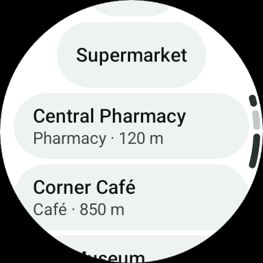 | 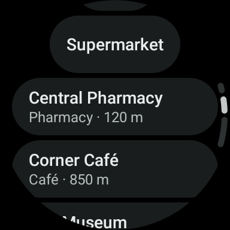 | 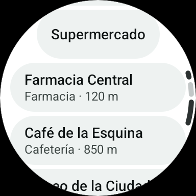 | 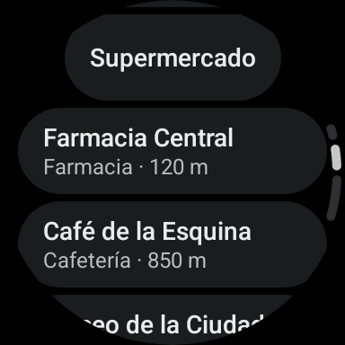 |
| Catalog: `StatusMessage` loading, empty, no connection, invalid key | 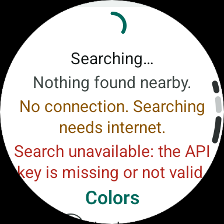 | 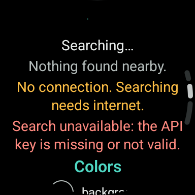 | 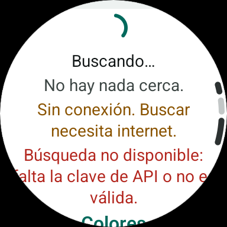 | 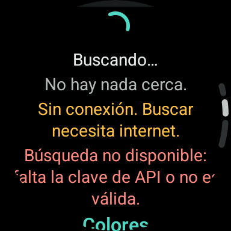 |
| Places debug, placeholder key | 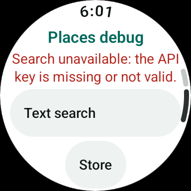 | 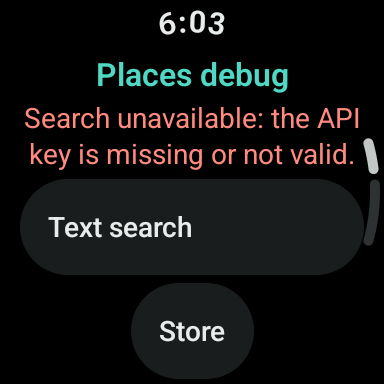 | 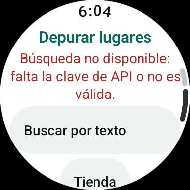 | 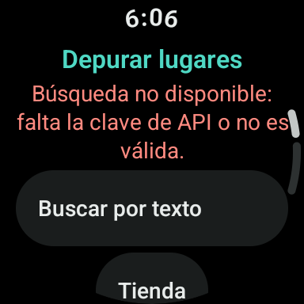 |
| Places debug, location off | 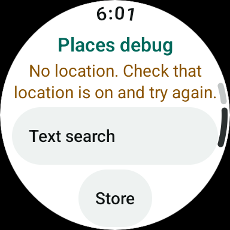 | 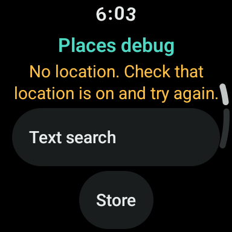 | 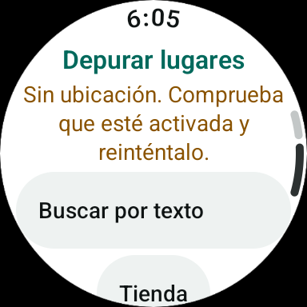 | 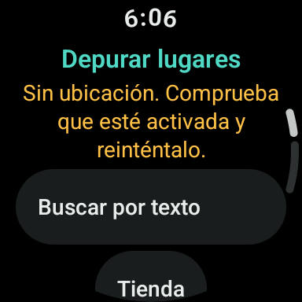 |
| Places debug, offline | 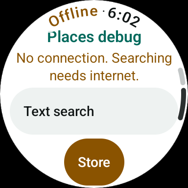 | 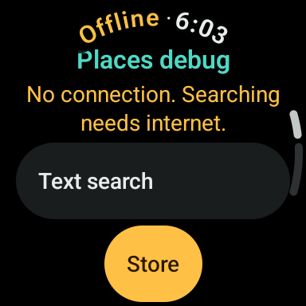 | 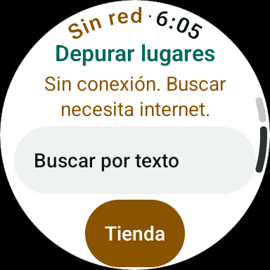 | 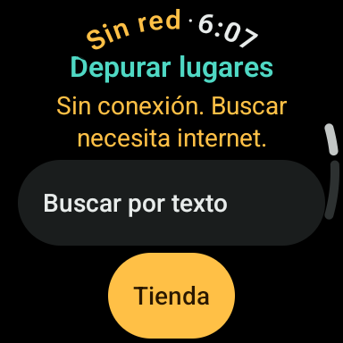 |

## Live verification checklist (needs the key)

### 1. Get and restrict the key

1. In Google Cloud Console, in a project with billing, enable **Places API (New)**
   (`places.googleapis.com`). The legacy "Places API" is not enough.
2. **APIs & Services → Credentials → Create credentials → API key.**
3. **Application restrictions → Android apps → Add:**
   - package `com.xanderjs.haptimap`
   - the SHA-1 of the debug certificate:
     `keytool -list -v -keystore ~/.android/debug.keystore -alias androiddebugkey -storepass android`
     (also add the release certificate's SHA-1 when there is one)
4. **API restrictions → Restrict key → Places API (New)** (add Routes API in step 05).

### 2. Put it in the project

In `local.properties` at the project root (ignored by Git), add a line:

```
MAPS_API_KEY=AIza…your key…
```

Then rebuild. Confirm the key is not tracked:

```bash
git status --short                              # local.properties must NOT appear
git check-ignore -v local.properties            # .gitignore:16:local.properties
git log -p --all | grep -cE 'AIza[0-9A-Za-z_-]{35}'   # 0
```

### 3. Commands

```bash
export ANDROID_SERIAL=emulator-5554 PATH=$PATH:~/Android/Sdk/platform-tools:~/Android/Sdk/emulator
./gradlew installDebug
adb emu geo fix -3.703790 40.416775                     # Puerta del Sol, Madrid (longitude first)
adb shell svc data enable && adb shell cmd location set-location-enabled true
adb shell cmd locale set-app-locales com.xanderjs.haptimap --locales en
adb shell cmd uimode night no
adb logcat -c && adb logcat -s HaptiPlaces HaptiSession  # keep it open in a second terminal
```

Open the app → catalog → **Places debug**.

### 4. Checks

| # | Action | Expected |
|---|---|---|
| 2 | Tap each of the 7 chips: Store, Hardware store, Restaurant, Café, Pharmacy, Transit, Supermarket | Each one: real places near Sol, ≤ 10 rows. The distances in the list never go down. Log: `Request from GeoPoint(40.416775, -3.70379), language en`, then `N places: [name d m, …]`. Spot-check 2 results per category: the distance from Sol to the place's coordinates (Google Maps "Measure distance") should match within a few meters. Transit should include metro/bus/train stations (e.g. "Sol"). An empty category shows "Nothing found nearby." |
| 3 | Text search → keyboard → type `museo del prado` → send | "Museo del Prado" near the top, about 1.0 km from Sol (1,0 km in Spanish). Also try a generic word (`churros`): results close to Sol, without a category line unless the type is one of the 7. |
| 4 | `adb shell cmd locale set-app-locales com.xanderjs.haptimap --locales es`, reopen Places debug, repeat Pharmacy and the Prado search | Log `language es`; names and the category line in Spanish ("Farmacia · 120 m"); kilometers with a comma ("1,2 km"). Back to `en`: English names where Google has them, and "1.2 km". |
| 4/9 | `adb shell cmd uimode night yes` / `no` in each language | Rows readable in both themes; no hardcoded colors. |
| 7 | Tap any result | Session debug opens with "Destination selected" and "Destination: <that name>"; `HaptiSession` logs `Searching + SelectDestination(…) -> DestinationSelected(…)`. Back → results still there. |
| 5 | `adb shell svc data disable`, wait 5 s, tap a chip; then `svc data enable` | "No connection…" at once, no `Request` line in the log. |
| 6 | Temporarily put a wrong key, or remove the app's SHA-1 from the restriction | "Search unavailable: the API key is missing or not valid." (400 / 403). |

Record the results in the table above and change 2, 3 and 4 from PENDING to Pass or Fail.

## Notes

- `adb shell input text` doesn't commit text to the Wear keyboard on the emulator (the text stays
  as a composing word, and send closes it without a result). Typing by tapping the keys works.
- Distances use haversine from the position at the moment of the search. With the 1.5 km radius,
  the sphere's error (< 0.5 %) is under 8 m.
- Text search keeps Google's relevance order. Only the category search is ranked by distance.
