# Step 05 — Google Routes

## Goal

Request a walking route from the user's position to the chosen `Place` with Routes API
(`computeRoutes`), and turn the response into a clean domain model (`Route`, `RouteStep`,
`Maneuver`) for the Navigation Engine (step 07) and the Haptic Engine (step 09). A ready route,
shown on a summary screen, is the end of this step.

Out of scope: following the route (07), haptics (09), route caching (06), and choosing between
alternatives (21).

## Decisions

| Decision | Why |
|---|---|
| New session state `RouteReady(route)` and event `StartNavigation` | Before, `RouteLoaded` went straight to `NavigationActive`. A ready route must not start navigation yet. `RouteLoaded`: `RouteLoading` → `RouteReady`. `StartNavigation`: `RouteReady` → `NavigationActive`. Agreed before implementing. |
| `Route`, `RouteStep`, `Maneuver`, `RouteResult`, `RouteError` in `:core:model` | `:core:network` builds the route and must not depend on the Navigation Engine. Same pattern as `Place` in step 04. The `Route` placeholder in `:core:navigation` is gone. Agreed before implementing. |
| Summary screen and ViewModel in `:feature:navigation-ui` | Agreed before implementing. The module gets Hilt + KSP the same way `:feature:onboarding` has them. |
| `Maneuver` = `TURN_LEFT`, `TURN_RIGHT`, `CONTINUE`, `ARRIVAL` | Semantic, with no Google strings. Every `*_LEFT` / `*_RIGHT` (slight, sharp, U-turn, fork, ramp, roundabout) is a turn. `STRAIGHT`, `DEPART`, `NAME_CHANGE`, `MERGE`, unknown or missing → `CONTINUE`. `RouteStep.sourceManeuver` keeps Google's value for later tuning. |
| A step's maneuver happens at its **start** | Google's convention. A zero-length `ARRIVAL` step is appended at the end of the last step, so "what to do next" is always the next step's maneuver. |
| Missing fields never fail the mapper | Step start/end comes from `startLocation`/`endLocation`, else the step's polyline, else the end of the previous step (the first falls back to the origin). Missing distance or duration is 0. |
| `decodePolyline` in `:core:model`, no dependency | About 20 lines. A truncated string returns the complete points without throwing (it comes from the network). |
| Field mask `ROUTES_FIELD_MASK` | `routes.distanceMeters, duration, polyline.encodedPolyline` and `legs.steps.distanceMeters, staticDuration, polyline.encodedPolyline, startLocation, endLocation, navigationInstruction`. One constant. |
| Request: `travelMode = WALK`, `units = METRIC`, `languageCode` = app language, origin as `latLng` | `computeAlternativeRoutes` comes from the `alternatives` parameter (default `false`). The first route is always used. |
| Destination as `placeId` when the `Place` has one, else `latLng` (`Place.toWaypoint()`) | With the place ID, Google routes to the place's entrance, not to the pin in the middle of a building. Places always gives an ID; the fallback covers places that don't come from Places. `googleJson` has `explicitNulls = false`, so a waypoint sends only one of the two. |
| Same key, client and headers as Places | `googleRetrofit()` (`GoogleApi.kt`) is the OkHttp client with `X-Goog-Api-Key`, `X-Android-Package` and `X-Android-Cert`, used by both APIs. `PlacesModule` became `GoogleApisModule`. |
| `MISSING_KEY` at once, before waiting for GPS | `isApiKeyConfigured()` treats a blank key or the `DEFAULT_API_KEY` placeholder as no key. `RoutesRepository.hasApiKey` lets the ViewModel check it next to the connectivity policy, before `firstPoint()`: the error appears at once (not after up to 10 s of GPS) and the session gets `RouteRequestRejected(ROUTE_UNAVAILABLE)`, never `RouteLoading`. The repository checks again before every request. Places keeps its step 04 behaviour (Google answers `API_KEY_INVALID`). |
| HTTP errors mapped through `placesErrorFor` | Same project, same key, so the codes mean the same: 429 → `API_QUOTA`; 403 and 400 `API_KEY_INVALID` → `API_INVALID_KEY`; other 4xx/5xx and malformed bodies → `API_ERROR`; `IOException` → `NO_CONNECTION`; `{}` → `NO_ROUTE`. |
| `RouteError` stays in the screen; the session keeps `SessionError` | `NO_CONNECTION` → `SessionError.NO_CONNECTION`, everything else → `ROUTE_UNAVAILABLE`. The reducer stays unchanged in its error handling. |
| Offline: `RouteRequestRejected`, never `RouteLoading` | As designed in step 03: entering `RouteLoading` is what fires the request. |
| `LocationSource.firstPoint()` in `:core:location` | The first-fix-with-10 s-timeout logic moved out of `PlacesDebugViewModel` so Places and Routes share it. |
| Choosing another place after a route replaces the destination | `PlacesDebugViewModel.selectPlace` first returns the session to `Searching`. Before, going back from the summary and tapping another result was ignored. |
| Flow | Places debug → tap a result → **Route summary** (requests the route) → Start → Session debug shows `Navigating`. |
| Screenshot tests: Compose Preview Screenshot Testing (`com.android.compose.screenshot` 0.0.1-alpha16) | Renders `@Preview`s with layoutlib, the same renderer as Studio, so `@HaptiPreviews` (round S/L, square × light/dark × en/es) works as is, with the real round masks. Roborazzi would need Robolectric to emulate Wear round screens. The plugin is experimental: it is enabled in `gradle.properties` and in each module that uses it (`:core:designsystem`, `:feature:navigation-ui`). |
| Fixed clock in previews (`10:10`) | `HaptiTimeText` uses a fixed `TimeSource` in inspection mode. With the live clock every reference image failed a minute later. |
| Destination name as its own first list item (`HeadingText`) | The first screenshots showed the title hidden under the clock: `TransformingLazyColumn` centers a first item taller than the screen. A short first item is clamped to the top. |
| Loading and error states in `CenteredScreenTemplate` | In the list template the message started in the narrow band under the clock and the round edge cut it (large round, and long texts on small round). Centered and at `dimens.centeredContentWidthFraction` (0.8) it fits in all 12 combinations. |
| Design system takes only UI values (follow-up) | `RouteSummary(RouteSummaryData)`, `StatusMessage(text, tone, loading)`, `PlaceRow(PlaceRowItem)`. The domain → UI mapping is in `RouteUi.kt` (route) and `:app` `PlaceUi.kt` (search); `Route.firstManeuver()` is pure and unit-tested; `:core:designsystem` no longer depends on `:core:model`. All 204 reference images validated unchanged (the 84 search-state ones moved to `:app` as byte-identical renames). See `DESIGN_SYSTEM.md` §1. |

## Acceptance criteria

1. Choosing a place requests a walking route from the current position; the session goes
   `DestinationSelected` → `RouteLoading` → `RouteReady`.
2. The summary shows the destination, total distance, estimated time and first maneuver, with a
   Start action that moves the session to `NavigationActive`.
3. Offline, no request is made and the no-connection message is shown.
4. Without a key, the missing-key message is shown, without a request and without a crash.
5. No route, invalid key, quota and other API errors each show a clear message.
6. Maneuvers, distances, durations, polylines and instructions are mapped into the domain model,
   with an `ARRIVAL` step at the end.
7. New UI uses design-system components only, in English/Spanish and light/dark, on round and square screens.
8. All tests pass, lint is clean, and no secret is in git.

## Verification (2026-10-28, no API key)

Only the checks that need live data are pending.

| # | Result | How it was checked |
|---|---|---|
| 1 | **Pass (unit) · PENDING live** | `RouteSummaryViewModelTest`: `RouteLoading` while waiting for the fix, `RouteReady(route)` after it, origin = the fix. Live: checklist below. |
| 2 | **Pass (unit)** | `start moves the ready route to NavigationActive`; `RouteSummary` previews. |
| 3 | **Pass (unit)** | Repository: `NO_CONNECTION`, `server.requestCount == 0`. ViewModel: `RouteRequestRejected`, never `RouteLoading`, 0 repository calls. |
| 4 | **Pass (unit)** | Repository: `missing key returns MISSING_KEY without a request`. ViewModel: `without a key the error shows at once, without waiting for GPS or calling the repository`. |
| 5 | **Pass (unit)** | MockWebServer: `{}` → `NO_ROUTE`, 400 `API_KEY_INVALID` and 403 → `API_INVALID_KEY`, 429 → `API_QUOTA`, other 400, 503 and malformed body → `API_ERROR`, dropped connection → `NO_CONNECTION`. |
| 6 | **Pass (unit)** | `RouteMapperTest` with JSON fixtures shaped like `computeRoutes` responses (Sol → Prado: `DEPART`, `TURN_SLIGHT_RIGHT`, `STRAIGHT`, `TURN_SHARP_LEFT`, `TURN_LEFT`, `NAME_CHANGE`, `TURN_RIGHT`, no maneuver; plus unknown maneuvers and missing fields). `PolylineTest`: Google's documented example, a negative point, empty and truncated input. |
| 7 | **Pass** | Screenshot tests: 9 states × 12 combinations = 108 reference images of the whole screen (`:feature:navigation-ui`), checked by `validateDebugScreenshotTest`. Table below. No raw colors, sizes or texts in the new `.kt` files. The spinner is a fixed 270° arc in previews and screenshots (layoutlib would capture an arbitrary animation frame); the app keeps the animated one. |
| 8 | **Pass** | `./gradlew assembleDebug lintDebug testDebugUnitTest :core:model:test :core:navigation:test validateDebugScreenshotTest`: **99 unit tests, 97 passed, 2 skipped** (`RoutesLiveTest`, pending the key) and **204 screenshot tests** passed (108 route screen, 96 Places components and states). Lint: 0 errors in every module; `:app` keeps the 23 warnings from step 04. `git log -p --all \| grep -cE 'AIza[0-9A-Za-z_-]{35}'` = 0; `local.properties` is ignored. |

### Screenshots

Five of the twelve combinations per state. All of them are in
`feature/navigation-ui/src/screenshotTestDebug/reference/`. Re-record after a UI change with
`./gradlew updateDebugScreenshotTest`, check with `./gradlew validateDebugScreenshotTest`.

| State | round S · light · en | round S · dark · es | round L · light · es | square · light · es | square · dark · en |
|---|---|---|---|---|---|
| Ready | 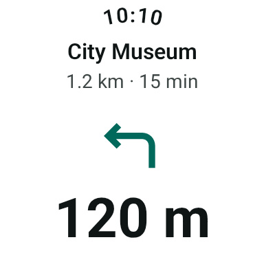 | 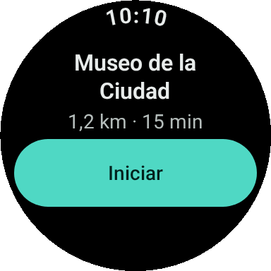 | 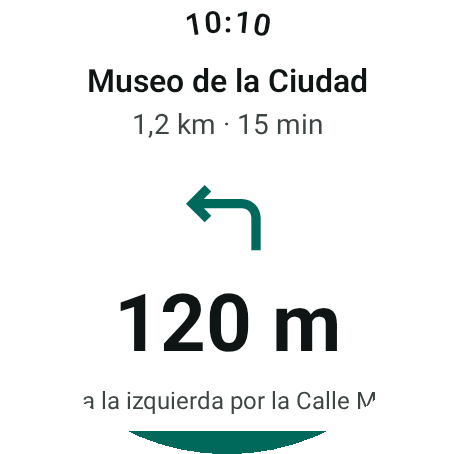 | 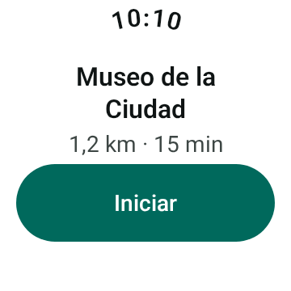 | 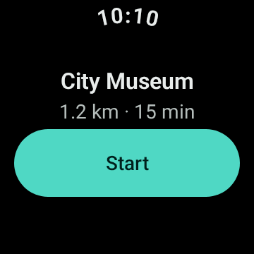 |
| Loading | 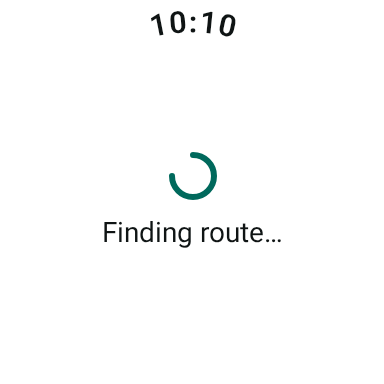 | 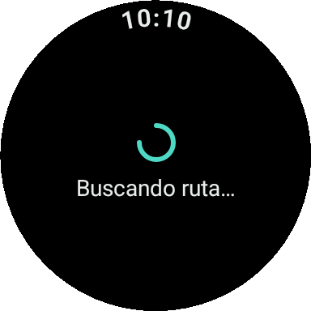 | 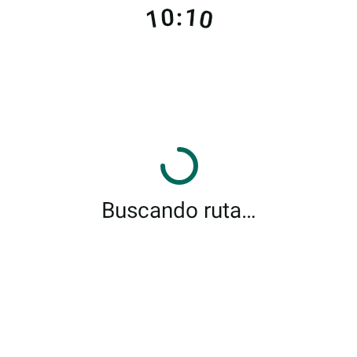 | 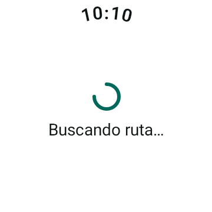 | 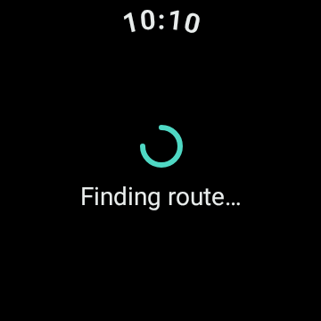 |
| No connection | 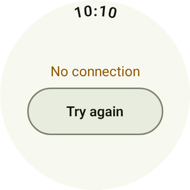 | 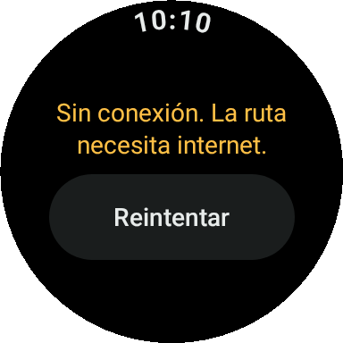 | 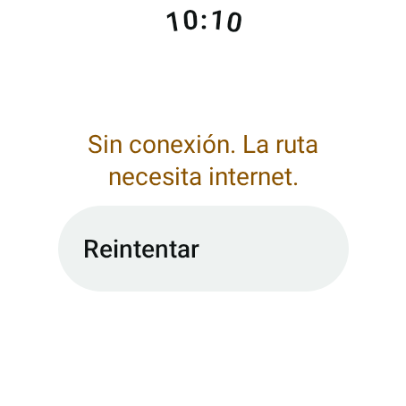 | 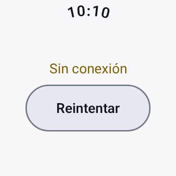 | 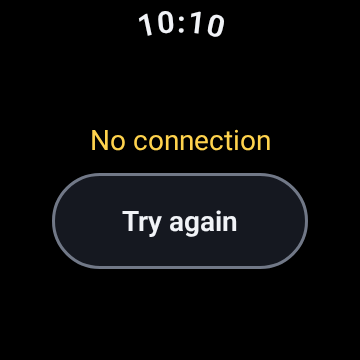 |
| No location | 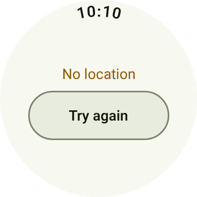 | 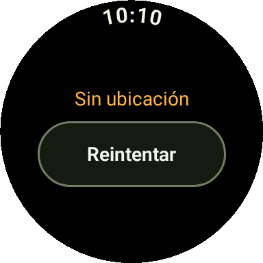 | 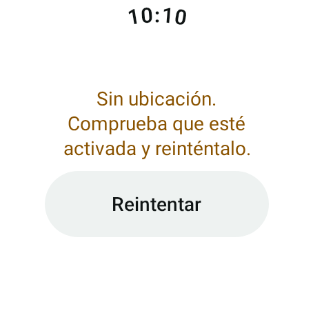 | 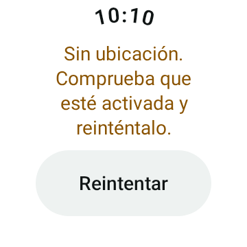 | 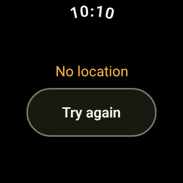 |
| No route | 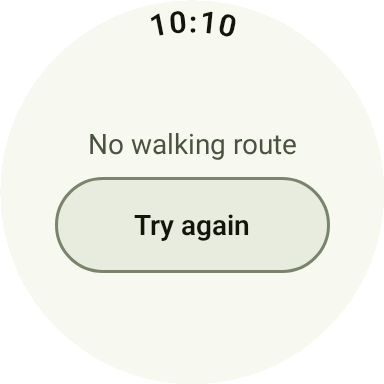 | 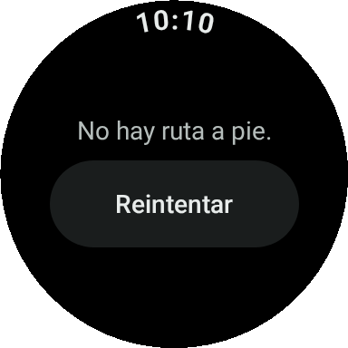 | 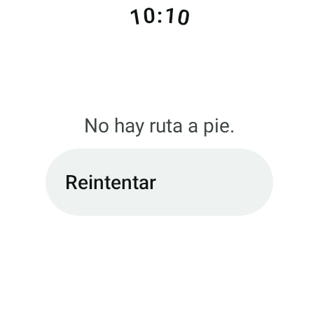 | 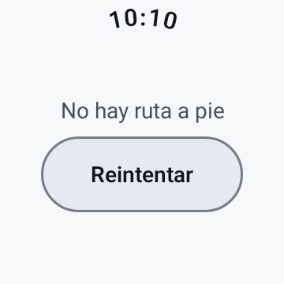 | 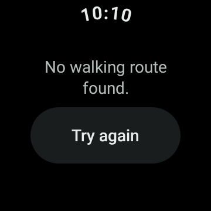 |
| Missing key | 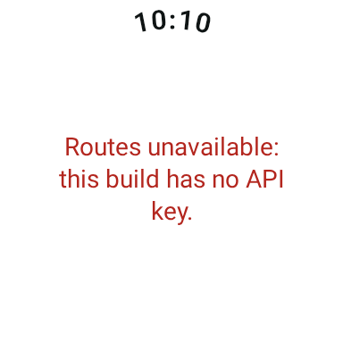 | 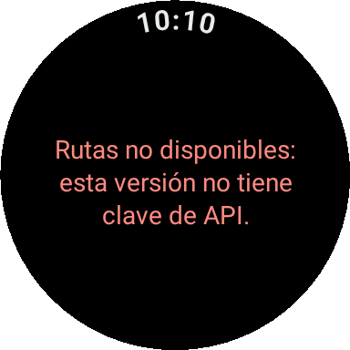 | 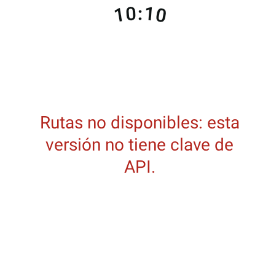 | 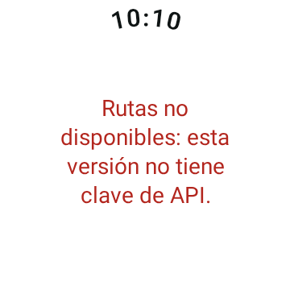 | 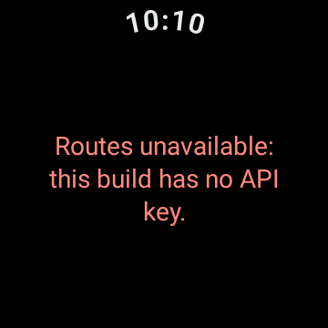 |
| Quota | 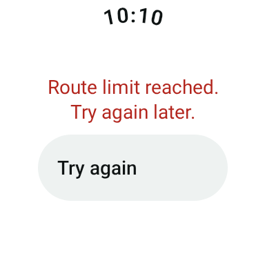 | 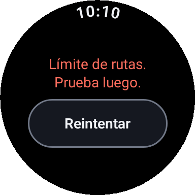 | 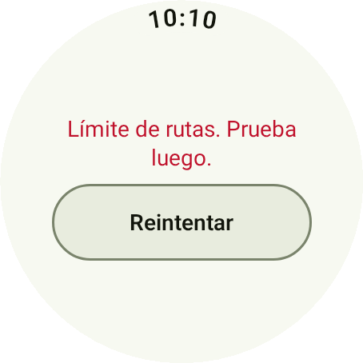 | 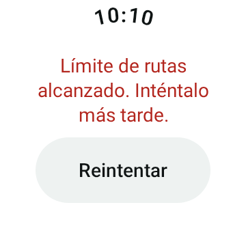 | 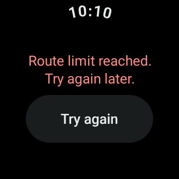 |
| Invalid key | 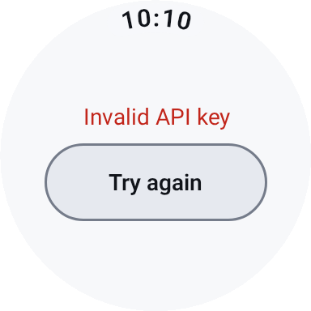 | 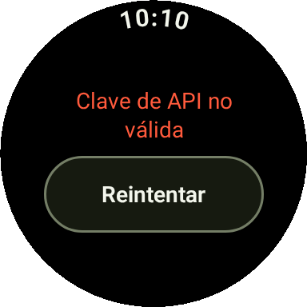 | 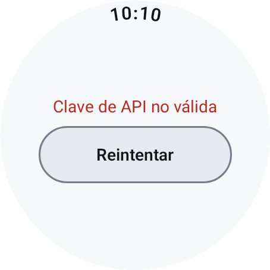 | 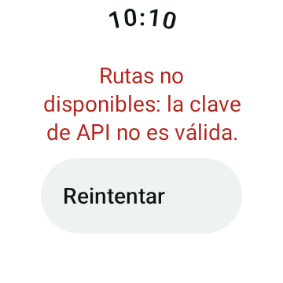 | 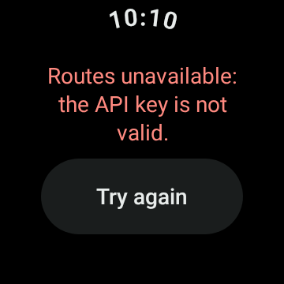 |
| API error | 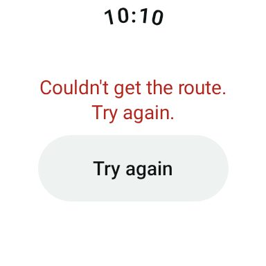 | 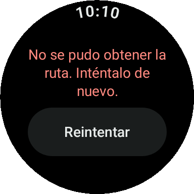 | 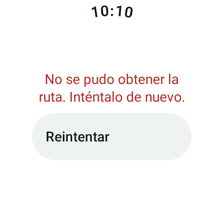 | 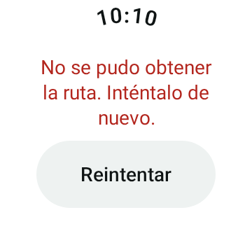 | 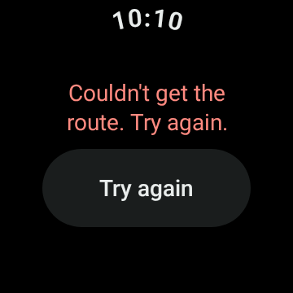 |

## Live verification (needs the key)

1. In Google Cloud Console, in the same project as Places, enable **Routes API**
   (`routes.googleapis.com`) and add it to the key's **API restrictions** next to Places API (New).
2. `MAPS_API_KEY=AIza…` in `local.properties` (see step 04, "Put it in the project").
3. Live test (searches the Prado with Places, routes to its place ID, and routes again by coordinates), from the project root:
   ```bash
   SHA1=$(keytool -list -v -keystore ~/.android/debug.keystore -alias androiddebugkey -storepass android | awk '/SHA1:/ {gsub(":","",$2); print $2}')
   MAPS_API_KEY=AIza… MAPS_CERT_SHA1=$SHA1 ./gradlew --no-daemon :core:network:testDebugUnitTest --tests '*RoutesLiveTest'
   ```
4. On the emulator (`adb logcat -s HaptiPlaces HaptiRoutes HaptiSession`, position at Sol):

| Action | Expected |
|---|---|
| Places debug → Pharmacy → tap the first result | "Finding route…", then the summary: name, "350 m · 5 min"-like stats, an arrow with a distance, Google's instruction, Start. Log: `HaptiRoutes: Request …`, `Route N m, …, [CONTINUE, TURN_…, …, ARRIVAL]`; `HaptiSession: … -> RouteReady(…)`. |
| Text search `museo del prado` → tap it | About 1.1 km and 14–16 min. |
| Start | Session debug shows "Navigating". |
| Back twice, tap another result | A new route to the new place. |
| `svc data disable`, wait 5 s, tap a result | "No connection. Routes need internet." at once; no `HaptiRoutes: Request` line; "Try again" works after `svc data enable`. |
| Language `es`, dark mode | Instructions in Spanish, "1,1 km · 15 min", readable in both themes. |
| Remove Routes API from the key's restrictions | "Routes unavailable: the API key is not valid." |
