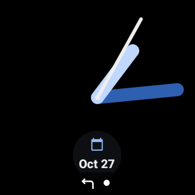
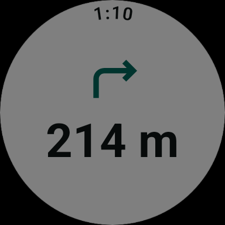
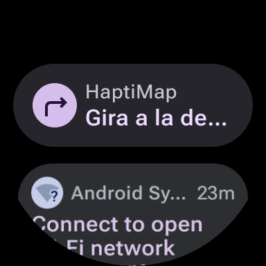
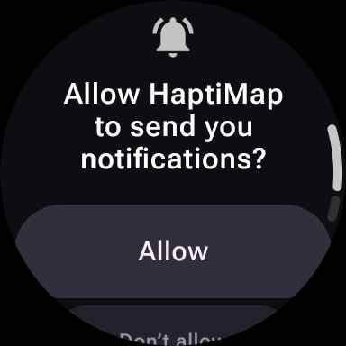

# Step 10 — Foreground service

## Goal

Keep navigation (GPS, engine, recalculation and haptics) running with the screen off, in ambient mode and
with the app in the background, using a location foreground service. Let the user return to the
navigation screen from the watch face. There is no physical watch until the end of version 1, so the
checks that need one are marked **pending: requires physical watch** and added to the step 14 checklist.
Full reference: [`ARCHITECTURE.md`](../../ARCHITECTURE.md), "Foreground service (step 10)"; notification:
[`DESIGN_SYSTEM.md`](../../DESIGN_SYSTEM.md) §15.

Out of scope, with the hook each later step will use:

| Step | Hook |
|---|---|
| 14 calibration | The checklist in [step 09](09-motor-haptico.md#real-watch-calibration-checklist-for-step-14), section 6: screen-off vibration, battery per hour, the Ongoing Activity on the real watch face |
| 23 adaptive GPS | The 1 s interval is unchanged. The wake lock is held for the whole service; with adaptive sampling it could be released between fixes (decide from the step 14 battery numbers) |
| AOD / ambient screen | `MainActivity` has no ambient support: in ambient the system shows a dimmed, frozen frame of the app (below). The service keeps navigation going regardless. **Done in [step 12](12-pantalla-eco-aod.md)** |

## Decisions

| Decision | Why |
|---|---|
| The service runs in `NavigationActive`, `OffRoute`, `Recalculating`, and for `ARRIVED_LINGER` (60 s) in `Arrived`; `Finish` / `Cancel` stop it at once | Agreed. `RouteReady` doesn't: nothing is followed yet, and a route resumed after process death lands there and must never start by itself. The 60 s let the arrival pattern play to the end and keep the notification as the way back to the arrival screen; without a limit an `Arrived` nobody dismisses would hold the service and wake lock forever. |
| The decision is one pure function, `navigationServiceRuns(states, linger)` in `:core:navigation` | Tested in virtual time against the real store and reducer, for every transition. The app and the service read the same function. |
| `HaptiMapApplication` only **starts** the service; the service **stops itself** with `stopSelf(lastStartId)` after `startForeground` | Stopping from outside could land before `startForeground` and crash the app ("did not then call startForeground"). The start id lets a newer start win. |
| `engine.follow` and `recalculator.follow` moved into the service, unchanged; `haptics.follow` stays on the app scope | Agreed. `HapticEngine.play()` only queues and `follow` plays, so the bench and the step 13 tutorial need it without navigation. During navigation the service keeps the process and the CPU alive, which covers the haptics anyway. |
| Partial wake lock for the whole service, 6 h limit | Fixes wake the CPU when they arrive, but what follows runs on `delay()`, which doesn't: the 100 ms haptic collapse window and 600 ms gap, the 10–60 s recalculation timers, the network request. Without it a cue could wait for the next fix. GPS at 1 Hz high accuracy already wakes the chip every second, so the added cost should be moderate; **measured in step 14**. 6 h is the route cache's maximum age and bounds a leak. |
| `START_NOT_STICKY` | After the system kills the process nothing restarts. The new process starts in `Idle` and Android doesn't allow a location service to start from the background anyway. Step 06 offers to resume the route, which needs a Start tap: navigation never resumes vibrating without the user knowing. |
| `POST_NOTIFICATIONS` requested from the route summary's Start (API 33+), navigation starts whatever the answer | Agreed. A permanent denial is not asked again: from Android 11 (minSdk 30) the system stops showing the dialog after the user denies twice and returns "denied" at once, so the app needs no state of its own. Checked on the emulator (below). Denied, the service runs the same; only the notification and the watch-face icon are missing. |
| Content: the screen's own mapping, `navigationUiState()`, extracted from `NavigationViewModel` with no logic change; then `toNotificationContent()` | Agreed. The notification can't disagree with the screen. The 13 `NavigationViewModelTest` tests pass unchanged. |
| Throttle: headline changes at once, distance-only at most every 5 s, identical never | A fix per second would rebuild the notification every second. Known limit (code comment): a held-back distance waits for the next change, so a stationary user can see a distance up to 5 s old. |
| Maneuver labels reuse `direction_*` (design system) and `navigation_arrived`; new strings only for the channel name and the status template | They already existed in English and Spanish. |
| Notification tap → `MainActivity` with `EXTRA_OPEN_NAVIGATION` and `FLAG_ACTIVITY_SINGLE_TOP`; a cold start during navigation goes to the catalog with the navigation screen on top | One way back from the watch face, recents and the notification list, whether the Activity is alive, on another screen or gone. The launcher gets the same cold-start rule, so with the notification denied the way back still works. |
| `wear-ongoing` 1.1.0 (stable, 2025-09) | Checked before implementing. Adds `setContentDescription` (used: the status text) and `RequiresPermission` on `update()` (not used: the app posts through `NotificationManagerCompat` after its own permission check). |
| API 35–37: no change for this service | Checked before implementing: Android 15 limits `dataSync` / `mediaProcessing` and `BOOT_COMPLETED` starts, Android 16 applies job quotas while a foreground service runs, Android 17 hardens background audio and `IntentSender` activity starts. None applies to a location service started from a tap. |
| Debug log line per notification post (`HaptiService` `notify …`) | At most one line every 5 s. With the screen off it is the evidence that fixes keep arriving, here and on the real watch in step 14. It is logged even when posting is denied. |
| The step 07 "Navigation" catalog entry removed | The Ongoing Activity and the notification replace it. |

## Acceptance criteria

1. A location foreground service with the manifest type and the permissions each API level needs (30–37), started only with the app in the foreground.
2. It runs while navigating and stops on `Idle` / `Completed`; `RouteReady` and `Arrived` decided and justified. Engine and recalculator wiring moved with no logic change; the start/stop decision pure and unit-tested. GPS interval unchanged. Wake-lock decision justified.
3. A low-priority ongoing notification with a Wear OS Ongoing Activity; tapping opens the navigation screen. Maneuver and distance, or the off-route / recalculating state; throttled. `POST_NOTIFICATIONS` denied doesn't break navigation and a permanent denial isn't asked again. Monochrome icons, English and Spanish, content mapping unit-tested. The step 07 catalog entry removed.
4. Process death never resumes navigation silently; swiping from recents doesn't stop it.
5. Unit tests for the controller, the content and the throttle. Emulator: screen off, ambient, background, Doze, recents, process kill, with timestamps. Step 14 checklist extended.
6. All tests pass, lint 0 errors, no secrets in git, logical commits; ARCHITECTURE, DESIGN_SYSTEM and this doc.

## Verification (2026-10-28)

| # | Result | How it was checked |
|---|---|---|
| 1 | **Pass (emulator)** | `dumpsys activity services`: `isForeground=true types=0x00000008` (location). Process state 4 (foreground service) with the app in the background. Permissions in the manifest since step 01; fine location checked before every start. |
| 2 | **Pass (unit + emulator)** | `NavigationServicePolicyTest` (6): search and a loaded route don't run it; a restored route stays off until Start; off route, recalculating, a failure and a new route keep it with no restart; arrival keeps it 60 s then stops; `Finish` during the 60 s stops it at once and nothing fires later; `Cancel` stops it from every running state. Emulator: start at `StartNavigation`, stop at `Cancel` (same ms), stop 60 s after `Arrived`. Wake lock: `dumpsys power` shows `PARTIAL_WAKE_LOCK 'HaptiMap:navigation'` from the start to the stop, released at `destroy`. **Its effect with the screen off: pending, requires physical watch** (the emulator's CPU never sleeps, and the debug simulator produces fixes with `delay()`, not through the fused location provider). |
| 3 | **Pass (unit + emulator)** | `NavigationNotificationTest` (7): every maneuver, every off-route status, arrival, ended; the stop dialog and notices don't change it; headline changes post at once; distance-only at most every 5 s, identical never. Emulator: the icon on the watch face follows the next maneuver; tapping it opens navigation from the watch face, from the catalog (`onNewIntent`) and after the task was removed (cold start); English and Spanish; permission flow below. **On a real watch face: pending, requires physical watch.** |
| 4 | **Pass (emulator)** | Task removed: same process, navigation continued. `kill -9`: nothing restarted; relaunch → resume prompt → `RouteReady`, no service until Start. |
| 5 | **Pass** | Below. Step 14 checklist: [step 09](09-motor-haptico.md#real-watch-calibration-checklist-for-step-14), section 6. |
| 6 | **Pass** | `testDebugUnitTest :core:model:test :core:navigation:test validateDebugScreenshotTest lintDebug`: all green; lint 0 errors in every module (`:app` 25 warnings, unchanged). No screenshot references changed (the catalog has none; `formatDistance` renders the same). `git diff` scanned for `AIza[0-9A-Za-z_-]{35}`: 0. |

## Emulator run with the simulator (2026-10-28)

Emulator `Wear_OS_Small_Round` (API 37), debug build, no API key, the sample route from the catalog.
`adb logcat -v time -s HaptiService HaptiSession HaptiHaptics HaptiReroute HaptiLocation`. Times are the
**emulator's clock**, which jumped forward about 2 h during the Doze test (see the note there). `notify`
lines are the service's posts: a distance update every 5 s means fixes keep arriving. The emulator
doesn't vibrate; `HaptiHaptics` `play` lines are the evidence.

**Run A, "Leave route"** (`StartNavigation` 22:59:06, service `create` 22:59:06.316, `start #1` .334, wake lock acquired .321)

| Scenario | How | Window | Fixes | Cues / haptics | Reroutes | Result |
|---|---|---|---|---|---|---|
| Side button | `input keyevent KEYCODE_POWER` | 22:59:16 – 23:00:39 | `notify` every 5 s (225 → 168 m), then 23:00:12 – 23:00:39 off route | 23:00:12.548 `OFF_ROUTE`; 23:00:24.565 `BACK_ON_ROUTE` | 23:00:22 `Recalculate`, `Request #1`; 23:00:24 `RouteRecalculated` (1106 m) | **Pass.** On Wear the side button is home, not screen off: this was the app in the background (the watch face showed the Ongoing Activity) |
| Screen off | `ambient_enabled 0`, `KEYCODE_SLEEP`: `mWakefulness=Dozing`, `mScreenState=OFF` | 23:00:49 – 23:02:25 | every 5 s, 666 → 533 m, no gap | none due (next turn > 500 m) | — | **Pass** for fixes; the cues with the screen off were seen in Doze and in run B |
| Doze | `dumpsys battery unplug`, `dumpsys deviceidle force-idle`: `mState=IDLE`, screen still off | 23:02:35 – ≈ 23:04:14, then the clock jump | every 5 s, 519 → 386 m; wake lock still held (`dumpsys power`) | — | — | **Pass.** At ≈ 23:04:14 the guest clock jumped to 01:04:5x; the simulator places the walker by wall-clock time, so it jumped to the end: 01:04:55.646 `Arrive`, 01:04:55.760 `ARRIVAL` (`dropped=[TURN_RIGHT, TURN_RIGHT]`, the two skipped turns collapsed into it) |
| Arrival linger | — | 01:04:55 – 01:05:55 | — | — | — | **Pass.** 01:05:55.718 `stop (session Arrived)`, `destroy`, wake lock released: exactly 60 s |

**Run B, "Walking"** (`StartNavigation` 01:10:47, service `start #1` 01:10:47.575)

| Scenario | How | Window | Fixes | Cues / haptics | Result |
|---|---|---|---|---|---|
| Ambient | `ambient_enabled 1`, `KEYCODE_SLEEP`: `mScreenState=DOZE` | 01:10:59 – 01:12:24 | every 5 s, 217 → 97 m | — (first turn later) | **Pass.** The system shows a dimmed frozen frame of the app (no ambient support yet) |
| Background | `KEYCODE_WAKEUP`, `KEYCODE_HOME`; process state 4 | 01:12:39 – 01:14:04 | every 5 s, 90 → 0 m, then the next maneuver 115 → 80 m | 01:13:19.843 `TURN_RIGHT` (20 m), 01:13:28.845 `TURN_IMMINENT` (6 m); the next maneuver (left) posted at once at 01:13:35, 3 s after the previous post | **Pass.** The watch-face icon switched to the left arrow |
| Tap the Ongoing Activity | Watch face, tap the icon | 01:14 | — | — | **Pass.** Navigation screen ("59 m"). Again from the catalog via home → icon: navigation ("34 m"), through `onNewIntent` |
| Swipe from recents | Wear's recents UI isn't reachable from adb (`KEYCODE_APP_SWITCH` does nothing); `am stack remove 17`, the same `removeTask` path | 01:15:06 – 01:16:09 | every 5 s, 247 → 163 m; same pid 6948 | 01:14:45.930 `TURN_LEFT`, 01:14:53.939 `TURN_IMMINENT` (just before) | **Pass.** Then tapping the icon cold-started the Activity on navigation ("142 m"); back → catalog. **The real recents gesture: pending, requires physical watch** |
| `am kill` | App in the background | 01:16:36 | kept arriving (121 → 93 m) | — | **Pass.** The process isn't killed while the service runs |
| Process kill | `run-as … kill -9 <pid>` | 01:16:57 | stopped | stopped | **Pass.** No restart after 30 s; no service, no notification; `active_route.json` kept. 01:17:36 relaunch → "Resume this route?" → Resume → route summary (`RouteReady`), service count 0 |

**`POST_NOTIFICATIONS`** (permission revoked and its flags cleared first):

| Start | Dialog | Navigation | Service | Notification |
|---|---|---|---|---|
| 1st | shown → Don't allow | started ("230 m") | running | none |
| 2nd | shown → Don't allow | started | running | none |
| 3rd | **not shown** (`USER_FIXED`) | started at once | running | none |

**Language, light and dark.** With the app in Spanish (`cmd locale set-app-locales … es-ES`): title
"Gira a la derecha", text "225 m", channel "Navegación". `cmd uimode night yes` / `no`: the watch face
and the notification list look the same (Wear's system UI is always dark); the icon is white on the
watch face and dark on the notification's light chip.

| Watch face, background | Ambient | Notification (EN) | Notification (ES) | Permission on Start |
|---|---|---|---|---|
|  |  |  |  |  |

**Emulator setup note.** The AVD crashed when started headless (`-no-window`, with and without
`-gpu swiftshader_indirect`): it lost its snapshot to the renderer change and died during the cold boot.
It ran with its normal window and GPU.

## Pending: requires physical watch

These can't be checked on the emulator. They are in the step 14 checklist
([step 09](09-motor-haptico.md#real-watch-calibration-checklist-for-step-14), section 6):

- **Wake lock**: whether turn patterns play on time with the screen off on a CPU that really sleeps. The emulator never sleeps, and the debug simulator doesn't use the fused location provider.
- **Screen-off vibration**: the patterns are felt with the screen off and in ambient, over a real walk, including after 30+ min (real Doze, not `force-idle`).
- **Battery drain** per hour of navigation, and the wake-lock time from `dumpsys batterystats`.
- **Ongoing Activity on the real watch face**: icon, status updates, tap, recents gesture, and the watch face's own light/dark styles.

## Pending and ideas

- ~~The collapsed notification row in the list cuts the status ("Turn right · …", "Gira a la de…"), so the distance isn't visible until it's opened.~~ **Done at the start of step 11** (approved): the status puts the distance first, "202 m · Tur…" / "174 m · Gira…", checked on the emulator in both languages ([step 11](11-modo-busqueda.md)).
- ~~Ambient support for the navigation screen (an AOD layout), so ambient shows live guidance instead of a frozen frame.~~ **Done in [step 12](12-pantalla-eco-aod.md).**
- If a stationary user's notification distance (up to 5 s old) matters, post the held-back content with a timer.
- A navigation longer than 6 h loses the wake lock; revisit with step 23.
