# Step 11 — Search Mode

## Goal

The app's entry point (product document §7): quick categories and voice input against Google Places, a
results list, and selecting a destination into the existing route flow, on a small round screen. Version 1:
one profile (Focus), so a selected place goes straight to its route; the Focus/Tour selector is step 16.
Full reference: [`ARCHITECTURE.md`](../../ARCHITECTURE.md), "Search Mode (step 11)"; components:
[`DESIGN_SYSTEM.md`](../../DESIGN_SYSTEM.md) §16.

Before it, a separate approved change from step 10: the notification status puts the distance first (below).

## Pre-implementation checks (2026-10-28)

| Check | Result | Effect on the plan |
|---|---|---|
| Wear Compose stable | `compose-material3` / `-foundation` / `-navigation` **1.7.1** (1.8.0-alpha02 newest); the project is on 1.5.6 | None: no new Compose API needed. Upgrading is a separate step (it would re-record every reference image) |
| `wear-input` | 1.2.0 stable, already in the catalog | Not needed for voice (below); removed with the step 04 debug screen, its only user |
| Speech input on Wear OS, API 30+ | developer.android.com "Voice input" (updated 2026-10-23): launch `RecognizerIntent.ACTION_RECOGNIZE_SPEECH` with `LANGUAGE_MODEL_FREE_FORM` through the Activity Result API and read `EXTRA_RESULTS` | Used. No new dependency, no `RECORD_AUDIO` (the system recognizer records), no `<queries>` (launching doesn't need package visibility; a missing recognizer throws `ActivityNotFoundException`) |
| Recognizers on the emulator (API 37) | `RECOGNIZE_SPEECH` is answered by Gboard's `WearRemoteInputActivity` and by Google's recognizer (`com.google.android.tts`) | Found during the emulator run: Gboard's keyboard fallback returns `EXTRA_RESULTS=[]`, see "Voice" below |

## Decisions

| Decision | Why |
|---|---|
| After selecting a result: the step 05 route summary, then Start | **Agreed.** The state machine goes `RouteLoading → RouteReady → StartNavigation`; step 10 needs Start to be a tap (foreground-service start, `POST_NOTIFICATIONS` request). One extra tap, no state-machine change |
| Search is the start screen; the catalog and debug screens are debug-only, from a button at the end of search | **Agreed.** Release builds open on search (after the permission and resume prompts); the catalog route isn't registered in release |
| With an active route: a row on top to go back to it, and `ConfirmDialog` before a new selection replaces it | **Agreed.** Searching never touches the session; only a confirmed replacement dispatches `Cancel`. "Keep route" changes nothing |
| Results on their own screen, sharing the search ViewModel through the nav back stack | Not specified. On a round screen a category at the bottom of the list would otherwise show its results above, out of view (the step 04 debug screen did that). Swipe-back returns to the categories. After process death the results screen has no query and pops back |
| Voice: `RecognizerIntent`, not `RemoteInput` | Not specified beyond "the standard way". Tried both on the emulator: `RemoteInput` opens a chooser (emoji / voice / keyboard), one more tap before speaking; `RecognizerIntent` opens listening. Follow-up: **agreed**, with `RemoteInput` as a fallback when it returns OK without text |
| `EXTRA_LANGUAGE` = the app language | So the words come back in the language Places is asked in (`languageCode`, step 04) when the app language differs from the watch's |
| Offline: a `Warning` notice on search; buttons stay enabled and answer "No connection" at once | Not specified. Disabled buttons would use Wear's disabled colors, which aren't checked for contrast in light mode; the notice explains before the user tries. The active route row stays usable offline |
| No-permission state: a message, no button | The app can't reach search without permission (it starts on the permission screen, and revoking kills the process), so a "grant" button would only be dead code. Covered by unit test and screenshots |
| Retry: not for empty results, an invalid key or no permission | Retrying can't fix them; for empty results the useful move is back and another search |
| Category label "Transport" (was "Transit") | The brief's name; Spanish was already "Transporte" |
| Icons: Material baseline `store`, `hardware`, `restaurant`, `local_cafe`, `local_pharmacy`, `directions_bus`, `local_grocery_store`, `mic` | The same set and style as the existing arrows and pin (filled, white, 24 dp). `storefront` rejected: too detailed at 24 dp |
| Debug, no API key: fake Places (`debugPlaces`) and Routes (`debugRoutes`) | Not asked. The project has no key, so without them the emulator can't go from a result to navigation. Same pattern as the step 07 sample route and step 08 fake reroute; the step 08 fake moved from `rerouteRequest()` into `debugRoutes`, which the route summary and recalculation now share. Release: unchanged Google repositories. Unit-tested (`DebugApisTest`); the step 08 simulation tests pass unchanged in behavior |
| Debug: a stand-in recognizer (`DebugSpeechActivity`), disabled by default | Not asked; the emulator workaround for voice (below). Enabled only by an explicit broadcast that requires `DUMP` (adb shell only) |

## Acceptance criteria

1. Seven categories with icons; each opens nearby places through the existing Places integration.
2. Voice with the standard Wear OS speech input, turned into a Places text search.
3. Results: name, category, approximate distance, short address. Selecting one goes `DestinationSelected → RouteLoading → RouteReady → NavigationActive` through the state machine.
4. States: loading, empty, Places errors, no location permission, offline (search unavailable, navigation not blocked).
5. An active navigation is never replaced silently.
6. Design-system components with tokens, in the catalog; strings in English and Spanish; screenshot tests in both themes and languages; unit tests for the ViewModel.
7. Lint 0 errors everywhere, `:app` warnings not above 25; no keys in git; small ordered commits; docs.

## Verification (2026-10-28)

| # | Result | How |
|---|---|---|
| 1 | **Pass (emulator, fake Places)** | Store, Pharmacy, Tienda: three results each, nearest first. Real Places needs a key: **pending** (step 14 checklist) |
| 2 | **Pass with a workaround (emulator)** | Real speech can't reach the emulator (below). The launch, the result path, cancel, "didn't catch that" and no recognizer were checked on the emulator; the text came from the stand-in recognizer |
| 3 | **Pass (unit + emulator)** | Rows show name, "Category · 150 m", address. Session log below, from a tap on a result to `NavigationActive` and the service start |
| 4 | **Pass (unit + screenshots + emulator)** | Every state in `SearchViewModelTest` and in the screenshots; on the emulator: loading, empty ("nothing" / "nada"), offline with navigation running, permission denied and granted. Places API errors on the emulator: step 04 already showed the invalid-key message; here unit tests and screenshots |
| 5 | **Pass (unit + emulator)** | "Keep route" left `NavigationActive` untouched; "Replace" logged `Cancel → Idle`, `StartSearch`, `SelectDestination`, service `stop`, new route |
| 6 | **Pass** | §16 of DESIGN_SYSTEM. 18 ViewModel tests. 168 new reference images (`SearchScreenshots` 36, `SearchScreenScreenshots` 120, `SearchNoPermission` 12) and the 12 `PlacesResults` re-recorded for the address line; the 84 moved `SearchStatusScreenshots` images are byte-identical to the old ones in `:app`; no other existing reference changed. Hard-coded values: the new `.kt` files were searched for `Color(0x`, `<n>.dp`, `<n>.sp` and `Text("…")`: none |
| 7 | **Pass** | `testDebugUnitTest :core:model:test :core:navigation:test validateDebugScreenshotTest lintDebug`: green; lint 0 errors in every module, `:app` 25 warnings (a debug-manifest change briefly made it 27; fixed with `DUMP` on the receiver and `taskAffinity` on the activity). `git diff` scanned for `AIza[0-9A-Za-z_-]{35}`: 0 |

## Emulator run (2026-10-28)

Emulator `Wear_OS_Small_Round` (API 37), debug build, **no API key** (fake Places and Routes), GPS from
`adb emu geo fix` near Sol. `adb logcat -v time -s HaptiSession HaptiService`. Times are the emulator's clock.

| Scenario | How | Result |
|---|---|---|
| Category search | "Store" | "Searching…", then three stores with category, distance and address |
| Result → navigation | "Store Calle del Prado" → summary → Start | 02:20:09.592 `SelectDestination` → .829 `RequestRoute` → 02:20:16.304 `RouteLoaded` (6.5 s: waiting for the first GPS fix) → 02:20:25.662 `StartNavigation` → `NavigationActive`; service `create` 25.786, `start #1` 25.857. **Pass** |
| Back to search while navigating | Back twice | "Navigating to Store Calle del Prado" on top; Store still selected. **Pass** |
| New place, keep | Pharmacy → a result → "Keep route" | Dialog "Replace the current route?"; no session event logged. **Pass** |
| New place, replace | Same → "Replace" | 02:22:10.661 `NavigationActive + Cancel → Idle`, `StartSearch`, `SelectDestination(Pharmacy…)`, .663 service `stop`, .677 `destroy`, then the new route. **Pass** |
| Loaded route row | Back to search with `RouteReady` | "Route ready: Pharmacy Calle de las Huertas", pin icon; tapping it opens the summary. **Pass** |
| Voice, Gboard | "Search by voice" | Gboard's listening screen opens at once. Its mic never received audio (below); "Didn't catch that. Try speaking again". Its keyboard: typed "Museo del Prado" → send → back in the app with `RESULT_OK` and `EXTRA_RESULTS=[]` (temporary log), so no search. **Corrected in the follow-up:** the text was typed with `adb shell input text`, which leaves it uncommitted; typed with key taps, Gboard returns it and the search runs |
| Voice, no recognizer | `pm disable-user` Gboard and Google TTS (0 handlers) | "No voice input" notice. **Pass** |
| Voice, stand-in recognizer | Enabled with the debug broadcast; typed "Museo del Prado" | Results titled "“Museo del Prado”". **Pass (workaround)** |
| Empty results | Voice "nothing" / "nada" | "Nothing found nearby." / "No hay nada cerca.", no retry. **Pass** |
| Offline | `svc wifi disable`, `svc data disable` | "Offline" in the clock band, "Search needs internet" notice; a voice search → "No connection. Searching needs internet." + Try again, without waiting for GPS. With the network still off, the loaded route started (summary showed "Works offline"); search showed "Navigating to…", and tapping it opened navigation. **Pass** |
| Permission denied | `pm revoke` fine and coarse, relaunch | The step 01 permission screen; "Don't allow" → "Sin ubicación, HaptiMap no puede guiarte…" + "Reintentar"; search not reachable. Granting ("Only this time") → search. **Pass** |
| Spanish, light | `set-app-locales es-ES`, `uimode night no` | Home with the active route and both notices, results, dialog "¿Cambiar la ruta actual?", summary "Iniciar", navigation; 02:33:46.841 `StartNavigation → NavigationActive(Tienda Calle del Prado)`. **Pass** |

The emulator was restored afterwards: Gboard and Google TTS re-enabled, the stand-in recognizer disabled, the
app locale and night mode back to the system's.

| Home (EN, dark) | Results | Navigating, back on search | Replace? | Voice results | Empty |
|---|---|---|---|---|---|
| 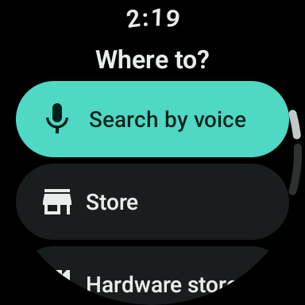 | 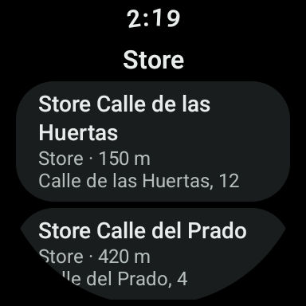 | 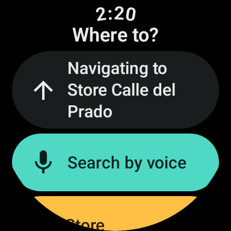 | 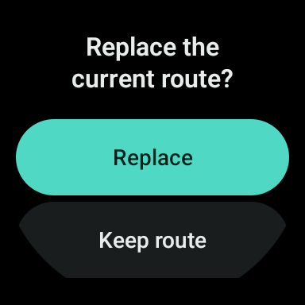 | 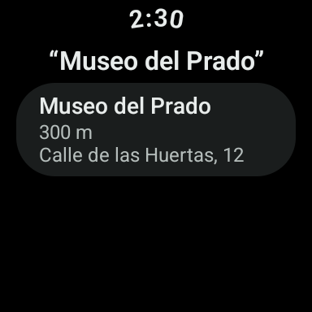 |  |

| Offline search (EN) | Offline, navigating (EN) | No recognizer (EN) | Home (ES, light) | Offline + no voice (ES) | Results (ES) |
|---|---|---|---|---|---|
| 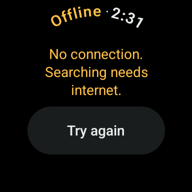 | 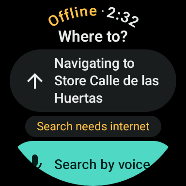 | 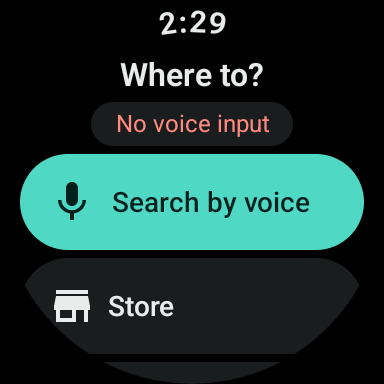 | 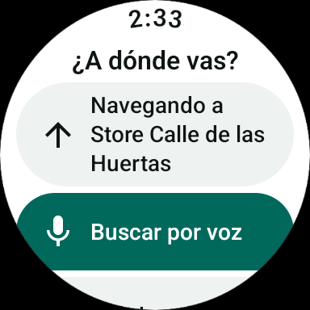 | 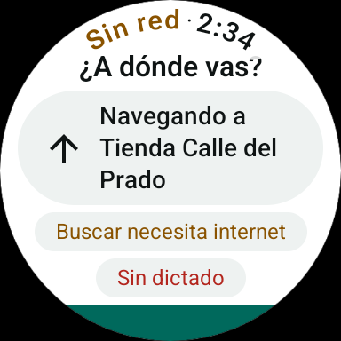 | 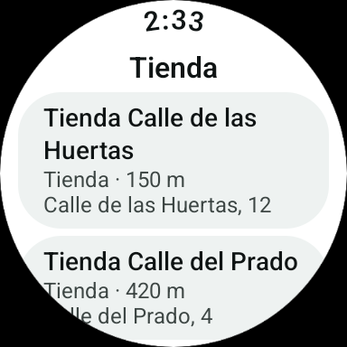 |

| Replace (ES) | Navigation (ES) | Empty (ES) | Permission denied (ES) | After granting (ES) | Gboard's speech UI |
|---|---|---|---|---|---|
| 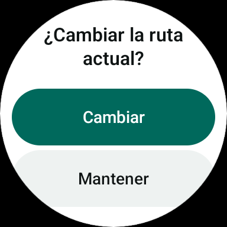 | 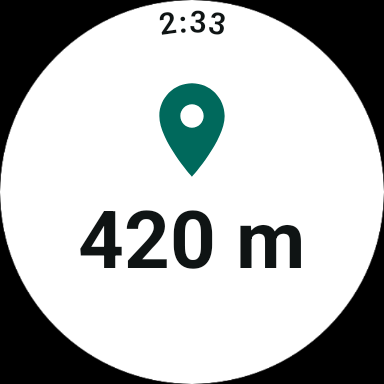 |  | 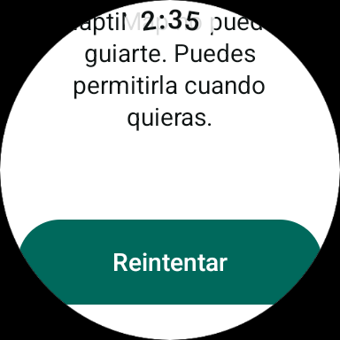 | 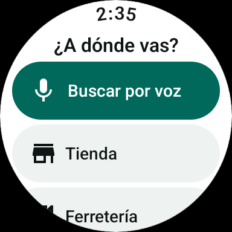 | 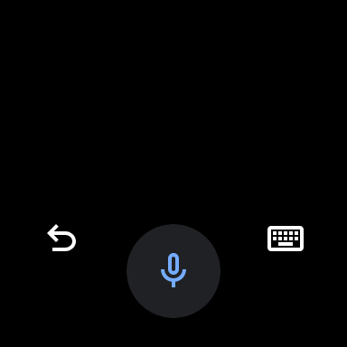 |

**Voice workaround, in detail.** The emulator's microphone never opened a host recording stream: with a
PipeWire null sink as the default source and `espeak-ng` playing "Prado Museum" into it, no source output
appeared while Gboard was listening, so the recognizer only heard silence (the host audio config was restored).
The stand-in `DebugSpeechActivity` (`src/debug`, disabled) answers `RECOGNIZE_SPEECH` like a recognizer: it shows
the `EXTRA_PROMPT` and returns what is typed in `EXTRA_RESULTS`. The app's launch and result code is the same
as with a real recognizer. To use it:

```bash
adb shell am broadcast -n com.xanderjs.haptimap/.debug.DebugSpeechToggle --ez enabled true
# with other recognizers installed Android asks which one; disable them for the test, re-enable after:
adb shell pm disable-user --user 0 com.google.android.inputmethod.latin   # and com.google.android.tts
adb shell input text "Museo%sdel%sPrado"; adb shell input keyevent KEYCODE_ENTER
```

## Notification: distance first (approved change from step 10)

`navigation_status` is now `%2$s · %1$s` in English and Spanish (text · title), so the collapsed row shows
"202 m · Tur…" / "174 m · Gira…" instead of "Turn right · …". Only the string order changed: no test asserts
the template (`NavigationNotificationTest` covers `toNotificationContent()`, which is unchanged), so no test
needed an update. Checked on the emulator in both languages:

| English | Spanish |
|---|---|
| 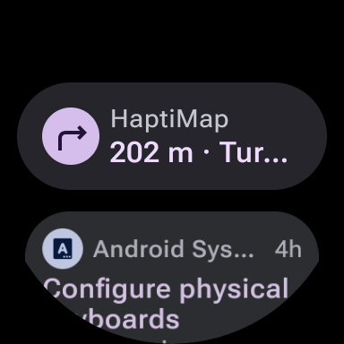 | 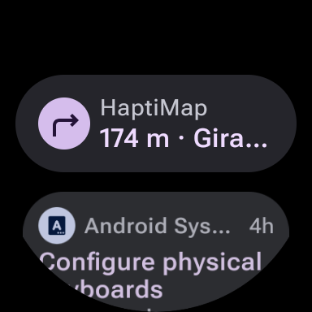 |

Off route the row now starts with "32 m from the route", and after arriving with the destination name.

## Pending: requires physical watch

In the step 14 checklist ([step 09](09-motor-haptico.md#real-watch-calibration-checklist-for-step-14), section 7):
real microphone and which recognizer answers; accuracy outdoors and walking in both languages; whether typed
text arrives through the watch's recognizer; outdoor readability of icons, notices and the address line in both
themes; the first view on the real screen; real Places results and distances (needs a key); crown scrolling and
taps while walking.

## Pending and design questions

- ~~Keyboard text through the speech UI~~, ~~the three-line active route row~~: decided and done in the follow-up (below).
- **Category order.** The product document's order; most-used first could come later from usage.
- ~~Disabled buttons offline~~: decided, keep the notice and enabled buttons.
- ~~The Wear Compose upgrade~~ and ~~the search screens in the review sheet~~: done in the follow-up (below).

## Follow-up (2026-10-28)

Decisions on the design questions above, in commit order:

| # | Decision | Done |
|---|---|---|
| 1 | Wear Compose 1.7.1, own commit, first | 1.5.6 → 1.7.1 and the Compose BOM 2024.09.00 → 2026.03.01 (UI 1.10.6), which 1.7.1 requires. Only the curved clock moved by a few pixels; no design-system component changed. A new lint error from `activity-compose` 1.10 fixed (`LocalContext as Activity` in the permission screen). [DESIGN_SYSTEM §17](../../DESIGN_SYSTEM.md) |
| 2 | Voice: keep `RecognizerIntent`; on `RESULT_OK` with no text, `RemoteInput` | `RemoteInput` with emojis off and its own prompt, "Type a place, business or address" / "Escribe un lugar, negocio o dirección"; its text searches like dictated text. `wear-input` 1.2.0 back, in `:feature:search` |
| 3 | The active route row on one line, as a design-system component | `ActiveRouteButton` (atom) and `HaptiButton(maxLines)`; the voice button is whole in the first view on all three shapes, with a long destination and both notices |
| 4 | Offline: keep the notice and enabled buttons | No change |
| 5 | The search screens in the review sheet | Seven rows: search, navigating + offline, route ready + no voice, results, empty, error + retry, the replace confirmation; 12 combinations each |

**Correction.** The step 11 run said Gboard's keyboard inside the speech screen returns `EXTRA_RESULTS=[]`. That was
the test, not Gboard: `adb shell input text` leaves the text as an uncommitted composition, and Gboard sends
nothing. Typed with key taps (`input tap` on the keys), the same screen returns the text and the search runs
straight from `RecognizerIntent`, with no `RemoteInput` in between (logcat: only the `RECOGNIZE_SPEECH` start). So
the fallback (#2) is not needed for Gboard's keyboard on the emulator; it covers any recognizer that answers
`RESULT_OK` without text. Whether that happens on the real watch is in the step 14 checklist.

**Emulator** (same setup as above, debug build, no key, Google TTS's recognizer disabled so Gboard answers):

| Scenario | Result |
|---|---|
| Speech screen → keyboard → `adb input text` → send (`RESULT_OK`, no text) | `RemoteInput` opens: "Type a place, business or address", voice and keyboard, no emoji. **Pass** |
| Then keyboard, typed with key taps, send | Back in the app, "“Prado”" results. **Pass** |
| Same in Spanish | "Escribe un lugar, negocio o dirección". **Pass** |
| Speech screen → keyboard typed with key taps → send | Search runs directly, no `RemoteInput`. **Pass** (and the correction above) |
| Speech screen → back (cancelled) | Back on search; no `RemoteInput` (logcat). **Pass** |
| Upgrade smoke test | Resume → summary → Start → navigation → back to search with "Navigating to …"; category search. No crash |

Checks: all unit tests, `validateDebugScreenshotTest` and `lintDebug` green; lint 0 errors in every module, `:app` 21
warnings (25 before the upgrade).

| `RemoteInput` fallback (EN) | Fallback (ES) |
|---|---|
|  |  |

~~Still open: on square with the Spanish offline label the curved clock touches the heading's "?".~~ Fixed at the start
of [step 12](12-pantalla-eco-aod.md): `clockBandSafeTop` is shape-aware.
