# Step 12 — Eco / AOD screen

## Goal

Display Mode A (product document §15): a minimal navigation view for low power. Haptics stay the main channel;
the screen only gives context: the next maneuver's arrow, an approximate distance and the essential status
(navigating, off route, recalculating, arrived, offline). It has two forms: the **Eco view** (interactive) and its
**ambient / AOD** variant, which replaces the frozen frame the app showed in ambient until step 10. Full reference:
[`ARCHITECTURE.md`](../../ARCHITECTURE.md), "Eco / AOD (step 12)"; components: [`DESIGN_SYSTEM.md`](../../DESIGN_SYSTEM.md) §18.

Before it, a separate fix: on square screens the curved clock touched the search heading (below).

## Pre-implementation checks (2026-11-04)

| Check | Result | Effect on the plan |
|---|---|---|
| Ambient API | developer.android.com "Always-on apps": observe ambient with `LocalAmbientModeManager` / `rememberAmbientModeManager()` (Compose) or `AmbientLifecycleObserver` (views). Our **Wear Compose Foundation 1.7.1 already has it** (`AmbientMode.Ambient(isLowBitAmbientSupported, isBurnInProtectionRequired)`, `AmbientTickEffect`, `withAmbientTick`; checked in the jar) | No new dependency. `currentAmbientMode` is snapshot state, so a composable just reads it |
| Default ambient behavior | Wear OS ≤ 5: a blurred screenshot with the time ("AOD Lite"). Wear OS 6+ with targetSdk ≥ 36: the app stays visible and dimmed, updated as rarely as once a minute ("Global AOD"). Observing ambient makes the app **ambiactive**: it draws its own ambient UI on every version | We target 37 and the emulator is API 37: the step 10 "frozen frame" was Global AOD |
| Burn-in | With `isBurnInProtectionRequired` **the system shifts the display**; apps must **not** shift pixels themselves. Avoid solid white areas; keep content ≥ 10 px from the edge (`ScreenScaffold` padding already does) | **Changed:** no pixel shifting in the app |
| AOD design rules | ≤ 15 % lit pixels; outlines, not solid fills; no animations; replace values that go stale between ticks; keep elements where they are in interactive; always show the time (`TimeText` is ambient-aware); low-bit: no anti-aliasing or gradients in custom drawing | Followed (below). Worst case measured: 6.2 % lit |
| Updates | `AmbientTickEffect` is about once a minute. An ambiactive app can also redraw when its own state changes | Event-driven redraws plus coarse distance steps (agreed), so a fix each second doesn't redraw |
| Foreground service and Ongoing Activity | On Wear OS 5+ the Ongoing Activity keeps the app visible past the second timeout instead of the watch face; its touch intent must point to the always-on Activity. Ours already does (`MainActivity`, `SINGLE_TOP`). Live Updates replace it on Wear OS 7+ (kept for later) | No change to the service |

## Decisions

| Decision | Why |
|---|---|
| Important events only vibrate; they never wake the screen | **Agreed.** Haptics are the main channel and the ambient view already shows the change; waking needs a screen-on wake lock and costs battery |
| Ambient distance in coarse steps: 10 m below 100 m, 50 m to 500 m, 100 m to 1 km, 500 m beyond (nearest) | **Agreed.** The ambient state only changes on a step, a maneuver or a status, so the view redraws a few times a minute while walking instead of every second |
| No manual pixel shifting | The current Wear guideline (above): the system does it. **Changes the brief**, which said "if required" |
| The Eco view **is** `NavigationScreen`; its first view (`NavigatingGlance`, `OffRouteGlance`, `ArrivedGlance`) is shared with ambient | Not specified beyond "refactor rather than build a second screen". No reference image of the navigation screen changed |
| Ambient = a theme state: `HaptiMapTheme(ambient = true)`, set at the app root | Not specified. The existing components adapt by themselves (outline arrow, no spinner, no pill fill, thin type), with no ambient copies. At the root because Wear composes the clock in `AppScaffold`, outside any screen's theme |
| The ambient view sits on top of **any** screen while navigating; without navigation the app shows what it had, in ambient colors | Not specified. Wear's guideline: show the most relevant screen in ambient. Leaving search in ambient while walking would hide the guidance |
| The screens under the ambient view are stopped (lifecycle capped at `CREATED`) | Not specified. Otherwise the navigation screen underneath recollects each fix and the window redraws every second, which cancels the coarse steps. On exit they recollect the current value (no stale data) |
| Ambient palette: one light gray (`Neutral75`) on black for every role, also warnings and errors | Not specified. No pure white (burn-in), no colors (low-bit screens map them unpredictably). The status text says what the color said |
| Ambient keeps the notice (weak GPS / works offline) and the clock's "Offline" | Offline is one of the listed statuses; weak GPS explains a wrong distance |
| Ambient drops: the instruction, remaining distance and time, distance to the route, the Stop button, the spinner | Secondary or stale between redraws, or an animation |
| The debug haptic badge still shows in ambient | Debug-only (empty in release). It's how the emulator shows that haptics keep playing |

## Acceptance criteria

1. Eco view: arrow, approximate distance, status (navigating, off route, recalculating, arrived, offline), reusing the existing navigation state and components.
2. Ambient: a dedicated layout instead of a frozen frame; black, few lit pixels, outlines, no fills, no animations; burn-in handled as Wear requires.
3. Ambient updates on maneuver change, off route, recalculating and arrival while the service runs, at low cost.
4. Wake on events: asked first (vibrate only); haptics unchanged.
5. Exiting ambient restores the full Eco view with current data.
6. Ambient visuals in `:core:designsystem` (tokens, components, catalog, screenshots); strings in both languages; both themes; documented.
7. Unit tests for the mapping; screenshot tests for Eco and ambient in both themes, both languages, three shapes, each status; review sheet; lint 0 errors, `:app` warnings not above the current count; small ordered commits; docs and the step 14 checklist.

## Square-screen clock fix (separate commit)

On square, with "Sin red · 10:10", the curved clock touched the "?" of "¿A dónde vas?". `clockBandSafeTop` is now
shape-aware in the design system: 8 dp on round, **16 dp on square** (`haptiDimens(round)`, provided by
`HaptiMapTheme` from `isScreenRound`). All three templates read it, so every screen with a top heading benefits.
Re-recorded only the square references that moved, 184 images (46 previews × 4): `SearchHome`,
`SearchHomeNavigatingOffline`, `SearchHomeRouteReadyNoVoice`, the 6 `SearchResults*` (incl. `NoPermission`), the
16 `Navigation*`, `ResumeRoute*` (3), the 11 `Route*` (summary, loading, errors), `Permission*` (5), `HapticsBench*`
(2). No round reference and no design-system component image changed. Checked on the square emulator with the real
clock ("Sin red · 21:16"): about 6 dp between the clock and the heading.

## Verification (2026-11-04)

| # | Result | How |
|---|---|---|
| 1 | **Pass** | `NavigationScreen` is the Eco view; the statuses are in `NavigationScreenshots` (unchanged images) and on the emulator |
| 2 | **Pass** | `AmbientNavigationScreenshots`: 9 states × 12 = 108 images; light and dark byte-identical; lit pixels ≤ 6.2 % (measured on the references). Emulator, three shapes |
| 3 | **Pass (emulator)** | Every transition reached the ambient view (table below). Frames (`dumpsys gfxinfo`), same walk, no haptic in the window: **interactive 30 frames / 30 s; ambient 4 frames / 60 s** |
| 4 | **Pass** | Asked; vibrate only. `HaptiHaptics` logs every turn, imminent, off-route, back-on-route and arrival pattern in ambient |
| 5 | **Pass (emulator)** | Wake after 3 min in ambient: "552 m" while the service had just posted 554 m; square "693 m"; large round "45 m" |
| 6 | **Pass** | DESIGN_SYSTEM §18; catalog section "Ambient (AOD)" / "Ambiente (AOD)" (the only new string). No new user-facing strings: ambient reuses the navigation ones |
| 7 | **Pass** | `AmbientNavigationTest` (6 tests); `testDebugUnitTest validateDebugScreenshotTest lintDebug` green; lint 0 errors in every module; `:app` 22 warnings, **the same 22 on the commit before this step** (re-linted in a worktree today: the brief's 21 was before a newer dependency version was published; all 22 are version/manifest notices, none in step 12 code) |

## Emulator run (2026-11-04)

API 37 Wear OS images; `ambient_enabled 1`; enter with `adb shell input keyevent KEYCODE_SLEEP` (`mWakefulness=Dozing`),
exit with `KEYCODE_WAKEUP`. Debug build, sample route, the step 08 walk simulator. Frames compared by hash every 2 s.

| AVD | Language · theme | Scenario | Ambient result | Haptics / service |
|---|---|---|---|---|
| Small round | EN · light | "Leave route": navigating → off route → recalculating → new route | 20:49:30 "200 m" (217 m real); 20:50:23 off route + "Head back to the route"; 20:50:33 "Finding a new route…" (no icon, no spinner); 20:50:35 "700 m" new route. Between events the frame stayed identical for 20+ s | `OFF_ROUTE` 20:50:23.5, `BACK_ON_ROUTE` 20:50:35.5; `notify` every 5 s throughout |
| Small round | EN · light | Exit after 3 min | Full Eco view with "552 m" (service 554 m two seconds earlier) | — |
| Small round | ES · dark · **airplane mode** | "Fast" walk to arrival | "Sin red · 21:07" clock, "Funciona sin red" notice without pill, arrows change right → left → right → left, steps 200/150/100/…/10 m, 21:10:45 "Has llegado" | `TURN_RIGHT`, `TURN_IMMINENT`, `TURN_LEFT`… 9 patterns, `ARRIVAL` 21:10:45.3; `Arrive` 21:10:45.2 |
| Small round | ES · dark | Ambient without navigation | No overlay; 2 frames in 3 min (the clock's minute) | — |
| Square | ES · offline | Search home (the clock fix) | — (interactive) The clock clears "¿A dónde vas?" | — |
| Square | EN · light | "Leave route" | Dark in a light theme; "200 m", then off route; exit → "693 m" | `LeaveRoute`, `Recalculate`, `RouteRecalculated` |
| Large round | ES · dark | Walking | "200 m" → "60 m"; exit → "45 m" with the instruction | — |

| Eco (EN, light) | Ambient | Off route | Recalculating | New route |
|---|---|---|---|---|
| 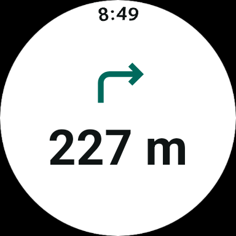 | 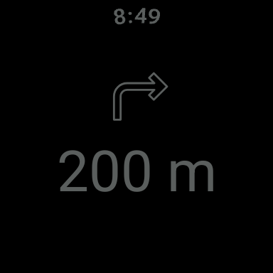 | 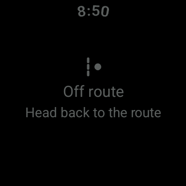 | 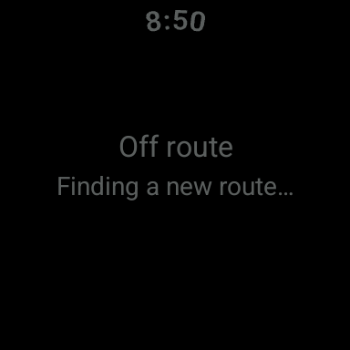 | 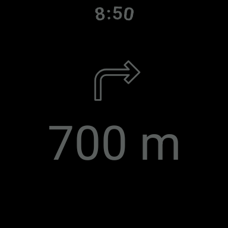 |

| Back to Eco | Offline (ES) | Arrival (ES) | Square search (ES, offline) | Square ambient | Square off route | Large round | Large round, back |
|---|---|---|---|---|---|---|---|
| 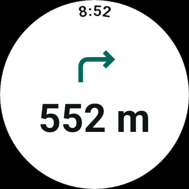 | 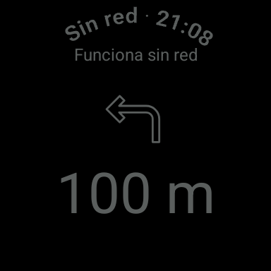 | 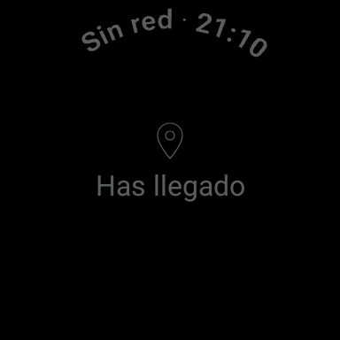 | 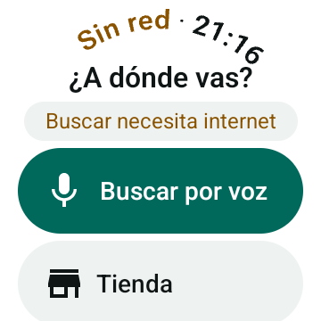 | 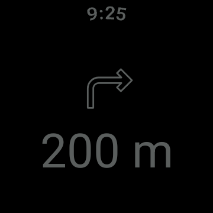 | 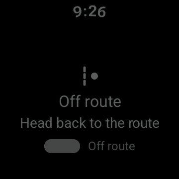 | 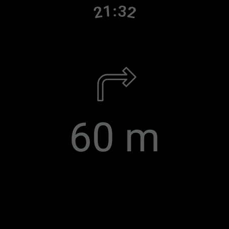 | 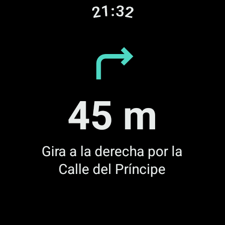 |

Captures are taken by `screencap`, which records the app's frame before the system dims the display; on the
emulator the dimmed gray shows as darker gray.

**Emulator notes.** The Large Round and Square AVDs were created for this step (`wearos_large_round`,
`wearos_square`, same API 37 image). The app falls back to the watch face after the second timeout when no
navigation is running (no Ongoing Activity then), which is the expected Wear behavior.

## Pending: requires physical watch

In the step 14 checklist ([step 09](09-motor-haptico.md#real-watch-calibration-checklist-for-step-14), section 8):
the real AOD look (dimming, gray level, how the watch shows outlines and thin type, low-bit), burn-in shifting,
battery cost of ambient against Global AOD and screen off, outdoor readability of the ambient view, and how often
the real watch lets an ambiactive app redraw.

## Pending and design questions

- **Position shift on entering ambient.** Eco centers the arrow and distance together with the instruction when
  it fits (large round); ambient centers them alone, so on large round they move down by about half the
  instruction's height. Keeping them fixed would mean ambient reserving the instruction's space. Is the shift
  acceptable?
- **Low-bit ambient.** Compose text and vector icons are always anti-aliased; Wear only asks to turn it off in
  custom `Canvas`/`Paint` drawing, which this view doesn't have. If a real low-bit screen shows halos, draw the
  arrows without anti-aliasing (step 14).
- **Ambient without navigation** (search, summary): the screen shows in ambient colors but has no layout of its own.
- **Live Updates** (Wear OS 7+) as the successor of the Ongoing Activity: later, with the step 10 notification.
