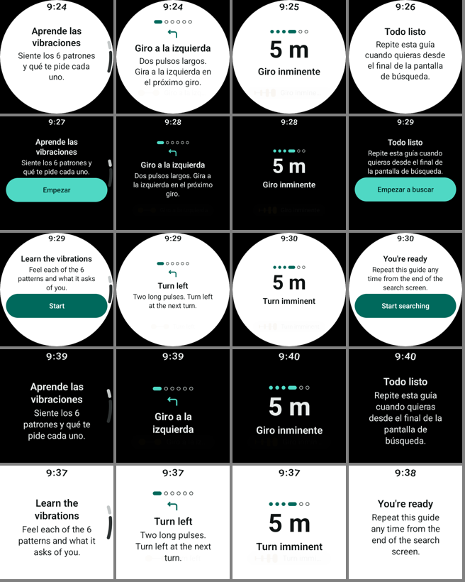
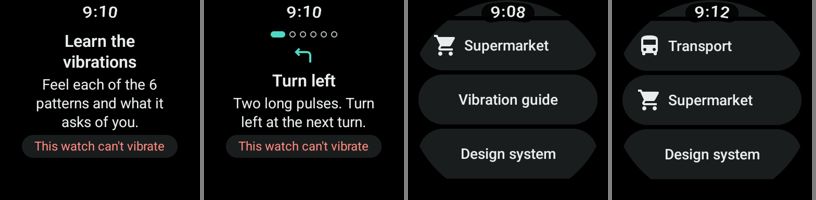

# Step 13 — Onboarding: haptic tutorial

## Goal

Product document §19: a short first-use tutorial so the user learns the vibration language before navigating,
pattern → meaning → action, repeatable later. Version 1 teaches six patterns: turn left, turn right, continue,
imminent turn, off route and arrival. The POI suggestion is version 2 (Tour mode, step 19): one more entry in
`hapticLessons`. Full reference: [`ARCHITECTURE.md`](../../ARCHITECTURE.md), "Onboarding (step 13)";
components: [`DESIGN_SYSTEM.md`](../../DESIGN_SYSTEM.md) §19.

## Step 12 check before starting (2026-11-05, small round, no code changes)

| Check | Result |
|---|---|
| Ambient redraws while walking, after the step 12 follow-up | **Pass.** 3 frames in a clean 60 s window (step 12: 4 / 60 s) |
| Off route → recalculating → new route in ambient | **Pass.** 08:25:05 "Fuera de ruta / Vuelve a la ruta" + `OFF_ROUTE`; 08:25:15 "Buscando otra ruta…" (no spinner); 08:25:17 new route "700 m" + `BACK_ON_ROUTE` |
| Frames on entering ambient | Twice, about 20 frames in the first ~5 s after entering. Not reproduced in 6 controlled entries, 3 on the build before the follow-up and 3 after (0–2 frames each), so not caused by it. Added to the step 14 checklist |

## Pre-implementation checks

| Check | Result | Effect |
|---|---|---|
| Wear OS onboarding guidance | No dedicated onboarding guide. The general rules: shallow, linear flows; no long text or scrolling for its own sake; built-in gesture hints instead of gesture tutorials ([UX principles](https://developer.android.com/design/ui/wear/guides/m2-5/foundations/getting-started), [gestures](https://developer.android.com/design/ui/wear/guides/patterns/gestures), [launch](https://developer.android.com/design/ui/wear/guides/m2-5/behaviors-and-patterns/launch)) | One linear flow, one idea per screen, Skip always reachable |
| Haptics availability | `Vibrator.hasVibrator()` tells a watch with no vibrator ([Vibrator](https://developer.android.com/reference/android/os/Vibrator)). **No public API says the user turned vibration off**; with `USAGE_ALARM` the system just mutes it ([VibrationAttributes](https://developer.android.com/reference/android/os/VibrationAttributes)) | No vibrator: said on screen, nothing asked of the engine. Vibration off: a hint on the welcome screen, always |
| Playing patterns | `HapticEngine.play(event)` already queues an event with the navigation rules (collapse window, gap, priority); `HaptiMapApplication` runs `follow()` for the whole process | The tutorial uses it; no raw vibration calls |
| Existing pieces | `HapticPatternCard`, `HapticWaveform` (step 09, "built for the step 13 tutorial too"), the navigation arrows and `ic_off_route`, `GlanceScreenTemplate`, `HeadingText` | Reused. New: `StepIndicator`, `BodyText` |
| Persistence | No DataStore in the project; one boolean | `SharedPreferences` (platform), no new dependency |

## Decisions

| Decision | Why |
|---|---|
| **Permission → tutorial → resume prompt / Search** on first launch | **Asked, agreed.** The permission screen already says HaptiMap guides with vibrations; the tutorial then ends ready to search. With permission already granted (reinstall, or an update from before step 13) the tutorial comes before the resume prompt |
| **Replay: "Vibration guide" / "Guía de vibraciones" row at the end of Search** | **Asked, agreed.** Existing secondary `HaptiButton`, works in release; moves to Settings in step 25. **Hidden while navigating** (not specified): the tutorial's patterns would mix with the route's cues on the same engine |
| Never during an active navigation | `startScreen()` returns Search when navigating, whatever the flag; the replay row is hidden while navigating |
| Each lesson plays once **from the action that opens it** (Start / Next), not from composition | Not specified. Coming back from ambient, screen off or process death doesn't replay it (tested). The step is in `SavedStateHandle` |
| "Seen" is saved on Skip and on **reaching** the done screen | Not specified. Swiping away on the done screen still counts. Swiping away the first-run tutorial before that doesn't: it shows again next launch |
| One destination with internal steps, `key(step)` per step | Not specified. Found on the emulator: without the key all lessons shared one scroll state and lessons 2–6 opened scrolled to "Next" |
| Quick taps on Next: the engine's own collapse keeps the newest lesson's pattern | Not specified. The tutorial order never lowers priority, so the current lesson always wins; no backlog (tested) |
| Lesson titles are the pattern names already used by the haptics bench (`haptic_*`), moved to `:feature:onboarding` with `HapticUi.kt` | Not specified. One name per pattern in the app. The bench and the debug badge now import them from there |
| Lesson visuals: navigation's own `DirectionArrow` (left, right, straight, arrive) and `ic_off_route` in `warning`; **imminent: `DistanceText` "5 m"**, no arrow | Not specified. `TURN_IMMINENT` carries no direction (the previous pattern did); the short distance is what navigation shows at that moment |
| Icons at `Medium`, as in navigation's arrival | Not specified. With `Large` the meaning didn't fit in any first view |
| `HapticPatternCard` is the "Play again" control | Not specified. It is a button already and shows the pattern's shape filling while it plays ("playing" state); the summary "2 pulses · 650 ms" helps read it without feeling it. Hidden without a vibrator |
| No vibrator: `NoticeLabel` "This watch can't vibrate" on welcome and every lesson; the lessons still teach the meanings | Not specified |
| Vibration-off hint ("Can't feel anything? Check that vibration is on in the watch settings.") on the welcome screen only, after Start | Not specified. Android can't detect it; on every lesson it would only push content down |
| Visuals are hidden from TalkBack; the step indicator reads "Step 2 of 6" | The title and the meaning already say what the drawing shows. TalkBack order: step, title (heading), meaning (how it feels, then what to do), "Play again, 2 pulses · 650 ms, double-tap to Play", Next, Skip |
| Debug: "Simulate no vibrator" in the catalog | The emulator always has a vibrator. `HapticsModule` is now per build type, like connectivity: debug wraps the player |
| `BodyText` atom | The permission screen drew its paragraph with a bare `Text`; both screens now use the atom (permission screenshots unchanged). It landed in its own commit after the logic commit |

## Acceptance criteria

1. Welcome, one screen per pattern (plays once, icon, meaning, Play again, Next), done screen to Search; Skip anywhere.
2. Patterns through `HapticEngine` semantic events only.
3. First launch only, persisted on completion or skip; placement agreed.
4. Replay entry point agreed; until step 25.
5. No vibrator, vibration off, screen off / ambient, active navigation.
6. New pieces in the design system with tokens, catalog and screenshots; same icons as navigation; strings in English and Spanish; both themes; three shapes; TalkBack.
7. Unit tests (state, first run), screenshots of every screen (12 combinations), review sheet, lint 0 errors and `:app` ≤ 22 warnings, docs, step 14 checklist.

## Verification (2026-11-05)

| # | Result | How |
|---|---|---|
| 1 | **Pass** | Emulator, all shapes; `TutorialScreenshots`: 11 screens × 12 = 132 references |
| 2 | **Pass** | `TutorialViewModelTest` runs the real `HapticEngine` with a fake player: each lesson plays its event once, Play again repeats it; logcat `HaptiHaptics play event=…` on the emulator |
| 3 | **Pass** | `StartScreenTest` (4); emulator: first launch, skip and complete both persist (`shared_prefs/onboarding.xml`), relaunch goes straight to Search |
| 4 | **Pass** | Emulator: replay from the row, Skip / Start searching return to Search |
| 5 | **Pass** | Unit test and emulator (debug toggle) for no vibrator; ambient mid-lesson: no replay; navigating: the row is hidden and the start screen is Search. Vibration off in settings: can't be detected (hint shown); not tried on the emulator |
| 6 | **Pass** | `StepIndicator`, `BodyText` in `:core:designsystem` with `stepDot` tokens, catalog and `TutorialPiecesScreenshots`; strings in `values` and `values-es` |
| 7 | **Pass** | `TutorialViewModelTest` (8), `StartScreenTest` (4); `testDebugUnitTest validateDebugScreenshotTest lintDebug` green; lint 0 errors in every module, 0 warnings outside `:app`, `:app` 22 (the baseline) |

## Emulator run (2026-11-05)

Debug build, API 37 images. Language with `cmd locale set-app-locales`, theme with `cmd uimode night`.

| AVD | Language · theme | Scenario | Result |
|---|---|---|---|
| Small round | EN · dark | Fresh install **without** permission | Permission → "While using app" → tutorial welcome |
| Small round | EN · dark | Start, Play again, Next × 5 | `TURN_LEFT TURN_LEFT TURN_RIGHT CONTINUE TURN_IMMINENT OFF_ROUTE ARRIVAL`. Found the shared-scroll bug here (fixed, re-run: each lesson opens on "Step n of 6") |
| Small round | EN · dark | Ambient in the last lesson | No pattern replayed on entering or leaving; same step |
| Small round | EN · dark | Done → "Start searching" | Search; `haptic_tutorial_seen=true`; relaunch → Search |
| Small round | EN · dark | Fresh install, Skip on welcome | Search; flag saved; relaunch → Search |
| Small round | EN · dark | Replay from "Vibration guide", Start, Skip | `TURN_LEFT`; back to Search |
| Small round | EN · dark | "Simulate no vibrator", replay | "This watch can't vibrate" on welcome and lesson; no play events |
| Small round | EN · dark | Navigating (sample route, walk), back to Search | No "Vibration guide" row |
| Small round | ES · light | Replay, whole flow | All six events in order; back to Search |
| Large round | EN | Fresh install, permission granted | Opens on the tutorial; Skip → Search |
| Large round | ES · dark / EN · light | Replay, whole flow | All six events in order, both runs |
| Square | EN | Fresh install, permission granted | Opens on the tutorial; Skip → Search |
| Square | ES · dark / EN · light | Replay, whole flow | All six events in order, both runs |

Welcome, turn left, turn now and done on small round (ES light), large round (ES dark, EN light) and square (ES dark,
EN light). The faint pill at the bottom is the debug haptic badge naming the pattern that is playing:

No vibrator (welcome, lesson); the replay row in Search; Search while navigating, without the row:

## Pending: requires physical watch

In the step 14 checklist ([step 09](09-motor-haptico.md#real-watch-calibration-checklist-for-step-14), section 9):
whether each pattern is clearly distinguishable on a real wrist, whether users tell left from right after the
tutorial, and what happens with vibration turned off in system settings.

## Design questions

- **First views.** The meaning fits in the first view on most lessons; Play again and Next are below the fold on
  the small round and on square in Spanish, as with the permission screen's rule (only whole items in the first
  view). **Turn now**'s "5 m" (`distance` style) pushes its meaning below the fold on every shape. A smaller
  distance, or the arrow with a "now" mark, would fit; it would differ from what navigation shows.
- **Welcome in Spanish on small round** shows only the title and the text; Start is one scroll away.
- **Swiping away the first-run tutorial** doesn't save it as seen: it shows again on the next launch. Alternative:
  count a swipe as Skip.
- **The vibration-off hint** is only on the welcome screen; a user who doesn't feel lesson 1 must remember it.
- The replay row is not visible in any reference image (it is at the end of the scrolling list); checked on the
  emulator in both languages.
